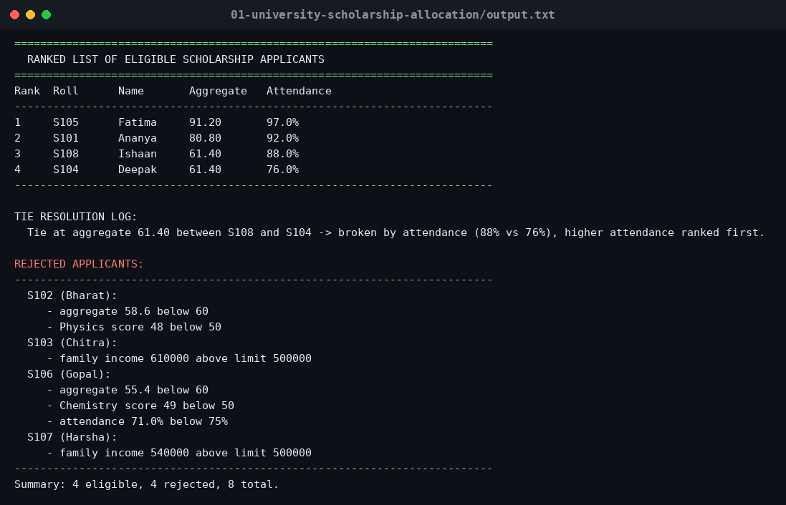

# Case Study 01 — University Scholarship Allocation

## Problem statement

Design a system that evaluates scholarship applicants using aggregate marks, subject-wise minimum scores, attendance and family income, ranks the eligible students, and resolves ties using predefined rules.

## Objectives

Represent applicant records with tuples and lists; apply multi-criteria eligibility with conditional statements; compute aggregates using loops and operators; rank eligible students with a composite tie-breaking key and report every rejection with its reason.

## Assumptions

Every applicant has five subject marks out of 100; aggregate is their arithmetic mean. Cutoffs: aggregate 60, each subject 50, attendance 75%, family income Rs 5,00,000. Ties are broken by attendance (higher first), then lower income, then roll number. All data is hypothetical.

## Algorithm

```
1. START
2. Define policy constants: MIN_AGGREGATE=60, MIN_SUBJECT=50,
   MIN_ATTENDANCE=75, MAX_INCOME=500000
3. SET eligible ← empty list, rejected ← empty list
4. FOR each applicant in APPLICANTS DO
   4.1 UNPACK applicant → roll, name, marks, attendance, income
   4.2 aggregate ← sum(marks) / len(marks)
   4.3 reasons ← empty list
   4.4 IF aggregate < 60            → append reason
   4.5 FOR i ← 0 to len(marks)-1 DO
           IF marks[i] < 50         → append reason (subject i)
       END FOR
   4.6 IF attendance < 75           → append reason
   4.7 IF income > 500000           → append reason
   4.8 IF reasons is empty  → append (roll,name,aggregate,att,income) to eligible
       ELSE                  → append (roll,name,reasons) to rejected
5. END FOR
6. SORT eligible by key (−aggregate, −attendance, +income, +roll)
7. PRINT ranked table (rank 1..n)
8. Scan adjacent rows: IF aggregates equal → PRINT tie-resolution log
9. PRINT each rejected applicant with every reason
10. PRINT summary counts
11. END
```

## Flowchart


## Pseudocode

```
BEGIN SCHOLARSHIP_ALLOCATION

    CONST MIN_AGGREGATE ← 60
    CONST MIN_SUBJECT   ← 50
    CONST MIN_ATTEND    ← 75
    CONST MAX_INCOME    ← 500000
    SUBJECTS ← ["Maths","Physics","Chemistry","English","CS"]

    FOR each applicant IN APPLICANTS DO
        (roll, name, marks, attendance, income) ← applicant
        aggregate ← SUM(marks) / LENGTH(marks)
        reasons ← []

        IF aggregate < MIN_AGGREGATE THEN
            APPEND "aggregate too low" TO reasons
        FOR i ← 0 TO LENGTH(marks)-1 DO
            IF marks[i] < MIN_SUBJECT THEN
                APPEND SUBJECTS[i] + " below minimum" TO reasons
        END FOR
        IF attendance < MIN_ATTEND THEN APPEND "attendance low" TO reasons
        IF income > MAX_INCOME      THEN APPEND "income above limit" TO reasons

        IF LENGTH(reasons) = 0 THEN
            APPEND (roll, name, aggregate, attendance, income) TO eligible
        ELSE
            APPEND (roll, name, reasons) TO rejected
    END FOR

    SORT eligible USING KEY (−aggregate, −attendance, income, roll)

    PRINT header
    FOR i ← 0 TO LENGTH(eligible)-1 DO
        PRINT rank i+1, eligible[i]
    END FOR

    FOR i ← 0 TO LENGTH(eligible)-2 DO
        IF eligible[i].aggregate = eligible[i+1].aggregate THEN
            PRINT "tie broken by attendance"
    END FOR

    FOR each r IN rejected DO PRINT r.roll, r.name, r.reasons

    PRINT summary
END
```

## Python source code

```python
"""
Case Study 01: University Scholarship Allocation
-------------------------------------------------
Syllabus: variables, data types, operators, conditional statements, loops,
lists, tuples, tuple unpacking, sorting / ranking.
"""

# ---------------- Policy constants ----------------
MIN_AGGREGATE = 60.0
MIN_SUBJECT_MARK = 50
MIN_ATTENDANCE = 75.0
MAX_FAMILY_INCOME = 500000
SUBJECTS = ["Maths", "Physics", "Chemistry", "English", "CS"]

# ---------------- Applicant records ----------------
# Tuple format: (roll, marks_list, attendance_percent, family_income)
APPLICANTS = [
    ("S101", "Ananya", [82, 76, 90, 71, 85], 92, 320000),
    ("S102", "Bharat", [55, 48, 62, 70, 58], 78, 480000),
    ("S103", "Chitra", [74, 69, 71, 66, 80], 84, 610000),
    ("S104", "Deepak", [61, 57, 64, 59, 66], 76, 495000),
    ("S105", "Fatima", [91, 88, 94, 87, 96], 97, 250000),
    ("S106", "Gopal", [58, 52, 49, 63, 55], 71, 300000),
    ("S107", "Harsha", [77, 72, 68, 74, 70], 80, 540000),
    ("S108", "Ishaan", [64, 58, 66, 60, 59], 88, 410000),
]


def evaluate(applicant):
    """Return (eligible, aggregate, reasons) for one applicant tuple."""
    roll, name, marks, attendance, income = applicant      # tuple unpacking
    aggregate = sum(marks) / len(marks)
    reasons = []

    if aggregate < MIN_AGGREGATE:
        reasons.append("aggregate %.1f below %.0f" % (aggregate, MIN_AGGREGATE))

    for i in range(len(marks)):                            # subject-wise minimum
        if marks[i] < MIN_SUBJECT_MARK:
            reasons.append("%s score %d below %d" % (SUBJECTS[i], marks[i], MIN_SUBJECT_MARK))

    if attendance < MIN_ATTENDANCE:
        reasons.append("attendance %.1f%% below %.0f%%" % (attendance, MIN_ATTENDANCE))

    if income > MAX_FAMILY_INCOME:
        reasons.append("family income %d above limit %d" % (income, MAX_FAMILY_INCOME))

    return (len(reasons) == 0), aggregate, reasons


def rank_key(record):
    """Tie-break rule: aggregate desc, attendance desc, income asc, roll asc."""
    roll, name, aggregate, attendance, income = record
    return (-aggregate, -attendance, income, roll)


def main():
    eligible = []
    rejected = []

    for applicant in APPLICANTS:
        ok, aggregate, reasons = evaluate(applicant)
        roll, name, marks, attendance, income = applicant
        if ok:
            eligible.append((roll, name, round(aggregate, 2), attendance, income))
        else:
            rejected.append((roll, name, reasons))

    eligible.sort(key=rank_key)

    print("=" * 74)
    print("  RANKED LIST OF ELIGIBLE SCHOLARSHIP APPLICANTS")
    print("=" * 74)
    print("%-5s %-9s %-10s %-11s %-10s" % ("Rank", "Roll", "Name", "Aggregate", "Attendance"))
    print("-" * 74)
    for i in range(len(eligible)):
        roll, name, aggregate, attendance, income = eligible[i]
        print("%-5d %-9s %-10s %-11.2f %-10s" % (i + 1, roll, name, aggregate, "%.1f%%" % attendance))
    print("-" * 74)

    # ---- detect and explain ties that were resolved ----
    print("\nTIE RESOLUTION LOG:")
    tie_found = False
    for i in range(len(eligible) - 1):
        if eligible[i][2] == eligible[i + 1][2]:
            tie_found = True
            a, b = eligible[i], eligible[i + 1]
            print("  Tie at aggregate %.2f between %s and %s -> broken by attendance "
                  "(%.0f%% vs %.0f%%), higher attendance ranked first."
                  % (a[2], a[0], b[0], a[3], b[3]))
    if not tie_found:
        print("  No ties occurred.")

    print("\nREJECTED APPLICANTS:")
    print("-" * 74)
    for roll, name, reasons in rejected:
        print("  %s (%s):" % (roll, name))
        for r in reasons:
            print("     - %s" % r)
    print("-" * 74)
    print("Summary: %d eligible, %d rejected, %d total."
          % (len(eligible), len(rejected), len(APPLICANTS)))


if __name__ == "__main__":
    main()
```

## Test cases

Eight automated checks: S101 accepted with aggregate 80.8; S102 rejected (aggregate 58.6 and Physics 48); S103 rejected for income; S106 rejected for attendance; S105 ranked first; the tie at 61.40 between S108 and S104 broken by attendance; totals 4 eligible / 4 rejected of 8. All pass (test_cases.py).

## Output screenshot



## Conclusion

The system screens applicants on all four criteria, ranks them deterministically, and explains every rejection. The tie-break key correctly ordered S108 above S104 at an equal aggregate of 61.40. Only tuples, lists, unpacking, loops, conditionals and operators were needed.
