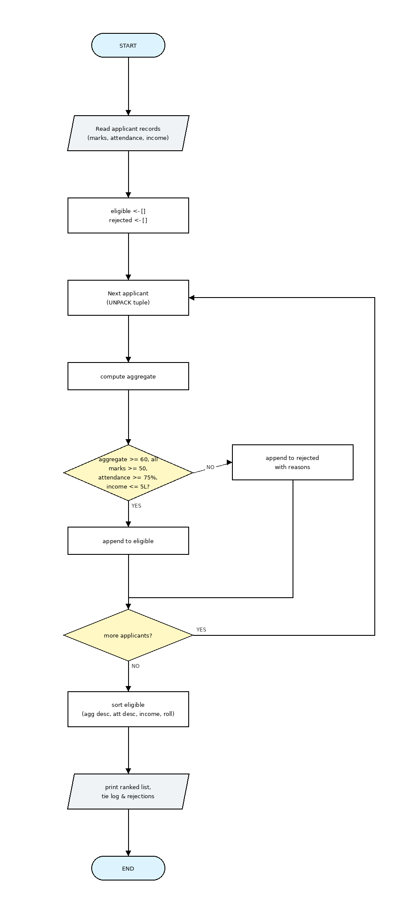

# Case Study 01 — University Scholarship Allocation

Repository: [Python-Activity-Based-Learning](../README.md)

## 1. Problem Statement

Design a system that evaluates university scholarship applicants using **aggregate
marks**, **subject-wise minimum scores**, **attendance**, and **family income**
criteria, **ranks** the eligible students, and **resolves ties** using predefined
rules.

Given a list of applicant records `(roll, name, marks[], attendance%, income)`,
the system must:

1. Reject any applicant whose aggregate is below 60, or who scores below 50 in
   any subject, or whose attendance is below 75%, or whose family income exceeds
   ₹5,00,000.
2. Rank all eligible applicants by aggregate (descending).
3. Resolve ties by: higher attendance first, then lower family income, then
   roll number (ascending).
4. Report every rejected applicant along with the exact reason(s).

## 2. Objectives

- Represent real-world records using **tuples** and **lists**.
- Apply **conditional statements** for multi-criteria eligibility.
- Compute aggregates with **operators** and **loops**.
- **Sort / rank** data with a composite **tie-breaking key**.
- Unpack nested data with **tuple unpacking**.
- Produce a formatted report of eligible and rejected applicants.

## 3. Assumptions

- Every applicant has exactly 5 subject marks (out of 100 each).
- Aggregate = arithmetic mean of the 5 marks.
- Income limit is ₹5,00,000; attendance limit is 75%; subject minimum is 50.
- All input data is hypothetical sample data.
- Ties on aggregate are broken strictly by the documented order:
  attendance ↓ → income ↑ → roll ↑.

## 4. Algorithm

```
1. START
2. Define policy constants: MIN_AGGREGATE=60, MIN_SUBJECT=50,
   MIN_ATTENDANCE=75, MAX_INCOME=500000
3. SET eligible ← empty list, rejected ← empty list
4. FOR each applicant in APPLICANTS DO
   4.1 UNPACK applicant → roll, name, marks, attendance, income
   4.2 aggregate ← sum(marks) / len(marks)
   4.3 reasons ← empty list
   4.4 IF aggregate < 60            → append reason
   4.5 FOR i ← 0 to len(marks)-1 DO
           IF marks[i] < 50         → append reason (subject i)
       END FOR
   4.6 IF attendance < 75           → append reason
   4.7 IF income > 500000           → append reason
   4.8 IF reasons is empty  → append (roll,name,aggregate,att,income) to eligible
       ELSE                  → append (roll,name,reasons) to rejected
5. END FOR
6. SORT eligible by key (−aggregate, −attendance, +income, +roll)
7. PRINT ranked table (rank 1..n)
8. Scan adjacent rows: IF aggregates equal → PRINT tie-resolution log
9. PRINT each rejected applicant with every reason
10. PRINT summary counts
11. END
```

## 5. Flowchart



Text version:

```
                        ┌─────────┐
                        │  START  │
                        └────┬────┘
                             ▼
                  ┌──────────────────────┐
                  │ read policy limits &  │
                  │ applicant records     │
                  └──────────┬───────────┘
                             ▼
                 ┌───────────────────────┐
                 │ eligible=[] rejected=[]│
                 └──────────┬────────────┘
                            ▼
              ┌──────────────────────────┐◄──────────────┐
              │ FOR each applicant       │               │
              └──────────┬───────────────┘               │
                         ▼                               │
              ┌───────────────────────┐                  │
              │ UNPACK tuple →        │                  │
              │ roll,name,marks,att,inc│                 │
              └──────────┬────────────┘                  │
                         ▼                               │
              ┌───────────────────────┐                  │
              │ aggregate = Σmarks / n│                  │
              │ reasons = []          │                  │
              └──────────┬────────────┘                  │
                         ▼                               │
        ┌────────────────────────────────┐               │
        │ aggregate≥60 AND all marks≥50  │──NO──► reject  │
        │ AND att≥75 AND income≤500000 ? │   +reasons ────┤
        └───────────────┬────────────────┘               │
                   YES  ▼                                │
              ┌───────────────────────┐                  │
              │ append to eligible    │                  │
              └──────────┬────────────┘                  │
                         └───────────────┬───────────────┘
                                         ▼
                          ┌────────────────────────┐
                          │ SORT eligible by       │
                          │ (agg↓, att↓, inc↑, roll↑)│
                          └───────────┬────────────┘
                                      ▼
                          ┌────────────────────────┐
                          │ print ranked table,    │
                          │ tie log, rejections,   │
                          │ summary                │
                          └───────────┬────────────┘
                                      ▼
                               ┌─────────────┐
                               │    END      │
                               └─────────────┘
```

## 6. Pseudocode

```
BEGIN SCHOLARSHIP_ALLOCATION

    CONST MIN_AGGREGATE ← 60
    CONST MIN_SUBJECT   ← 50
    CONST MIN_ATTEND    ← 75
    CONST MAX_INCOME    ← 500000
    SUBJECTS ← ["Maths","Physics","Chemistry","English","CS"]

    FOR each applicant IN APPLICANTS DO
        (roll, name, marks, attendance, income) ← applicant
        aggregate ← SUM(marks) / LENGTH(marks)
        reasons ← []

        IF aggregate < MIN_AGGREGATE THEN
            APPEND "aggregate too low" TO reasons
        FOR i ← 0 TO LENGTH(marks)-1 DO
            IF marks[i] < MIN_SUBJECT THEN
                APPEND SUBJECTS[i] + " below minimum" TO reasons
        END FOR
        IF attendance < MIN_ATTEND THEN APPEND "attendance low" TO reasons
        IF income > MAX_INCOME      THEN APPEND "income above limit" TO reasons

        IF LENGTH(reasons) = 0 THEN
            APPEND (roll, name, aggregate, attendance, income) TO eligible
        ELSE
            APPEND (roll, name, reasons) TO rejected
    END FOR

    SORT eligible USING KEY (−aggregate, −attendance, income, roll)

    PRINT header
    FOR i ← 0 TO LENGTH(eligible)-1 DO
        PRINT rank i+1, eligible[i]
    END FOR

    FOR i ← 0 TO LENGTH(eligible)-2 DO
        IF eligible[i].aggregate = eligible[i+1].aggregate THEN
            PRINT "tie broken by attendance"
    END FOR

    FOR each r IN rejected DO PRINT r.roll, r.name, r.reasons

    PRINT summary
END
```

## 7. Python Source Code

Complete, runnable source: **[`solution.py`](./solution.py)**

Key logic (eligibility + ranking):

```python
def evaluate(applicant):
    roll, name, marks, attendance, income = applicant      # tuple unpacking
    aggregate = sum(marks) / len(marks)
    reasons = []
    if aggregate < MIN_AGGREGATE:
        reasons.append("aggregate %.1f below %.0f" % (aggregate, MIN_AGGREGATE))
    for i in range(len(marks)):
        if marks[i] < MIN_SUBJECT_MARK:
            reasons.append("%s score %d below %d" % (SUBJECTS[i], marks[i], MIN_SUBJECT_MARK))
    if attendance < MIN_ATTENDANCE:
        reasons.append("attendance %.1f%% below %.0f%%" % (attendance, MIN_ATTENDANCE))
    if income > MAX_FAMILY_INCOME:
        reasons.append("family income %d above limit %d" % (income, MAX_FAMILY_INCOME))
    return (len(reasons) == 0), aggregate, reasons

def rank_key(record):
    """Tie-break: aggregate desc, attendance desc, income asc, roll asc."""
    roll, name, aggregate, attendance, income = record
    return (-aggregate, -attendance, income, roll)
```

Run: `python3 solution.py`

## 8. Test Cases

Automated suite: [`test_cases.py`](./test_cases.py) — **8/8 passing**
(`python3 test_cases.py`).

| ID | Input | Expected | Actual | Status |
|----|-------|----------|--------|--------|
| TC-01 | S101 Ananya: [82,76,90,71,85], 92%, ₹3,20,000 | eligible, aggregate 80.8 | eligible, 80.80 | PASS |
| TC-02 | S102 Bharat: [55,48,62,70,58] | rejected (aggregate 58.6 < 60) | rejected, 58.6 | PASS |
| TC-03 | S102 subject Physics = 48 | subject-wise violation reported | "Physics score 48 below 50" | PASS |
| TC-04 | S103 income ₹6,10,000 | income violation reported | "family income 610000 above limit" | PASS |
| TC-05 | S106 attendance 71% | attendance violation reported | "attendance 71.0% below 75%" | PASS |
| TC-06 | rank all eligible | highest aggregate first | S105 (91.20) ranked #1 | PASS |
| TC-07 | S108 vs S104 both 61.40 | tie broken by attendance (88 > 76) | S108 ranked above S104 | PASS |
| TC-08 | all 8 applicants | 4 eligible / 4 rejected | 4 / 4 | PASS |

## 9. Output


Full text output: [`output.txt`](./output.txt)

```text
Rank  Roll      Name       Aggregate   Attendance
1     S105      Fatima     91.20       97.0%
2     S101      Ananya     80.80       92.0%
3     S108      Ishaan     61.40       88.0%
4     S104      Deepak     61.40       76.0%

TIE RESOLUTION LOG:
  Tie at aggregate 61.40 between S108 and S104 -> broken by attendance
  (88% vs 76%), higher attendance ranked first.

Summary: 4 eligible, 4 rejected, 8 total.
```

## 10. Conclusion

The system successfully models the complete scholarship workflow — multi-criteria
eligibility screening, deterministic ranking, and explainable rejections — using
only tuples, lists, tuple unpacking, loops, conditionals, and operators. The
designed tie-break key proved essential: two applicants tied at 61.40 were
correctly ordered by attendance. The automated tests confirm that every policy
rule fires exactly when it should, and the ranked report is ready for direct
use by the scholarship committee.
