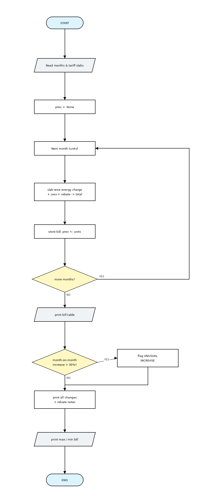
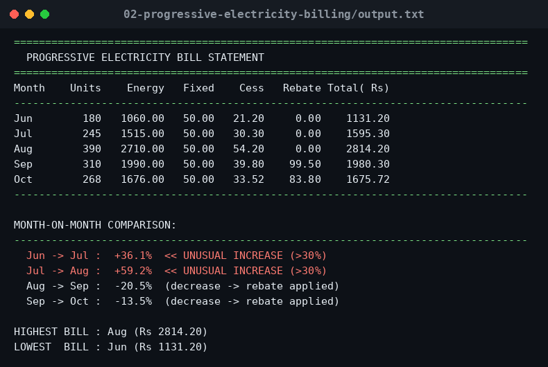

# Case Study 02 — Progressive Electricity Billing

## Problem statement

Calculate household electricity bills using multiple consumption slabs, fixed charges, surcharges and rebates, then compare bills across several months and identify unusual increases.

## Objectives

Implement slab-wise tariff arithmetic with loops and operators; apply the cess, rebate and unusual-increase rules with conditional statements; store monthly data as tuples and compare consecutive months by percentage change.

## Assumptions

Slabs: 0-100 at Rs 5, 101-300 at Rs 7, 301-500 at Rs 9, above 500 at Rs 12, applied progressively. Fixed charge Rs 50; 2% cess on the energy charge; 5% rebate when consumption falls below the previous month. A rise above 30% month-on-month is unusual. Data is hypothetical.

## Algorithm

```
1. START
2. Define SLABS, FIXED=50, CESS=2%, REBATE=5%, UNUSUAL=30%
3. READ list of (month, units)
4. prev ← None
5. FOR each (month, units) DO
   5.1 energy ← 0; remaining ← units; lower ← 0
   5.2 FOR each (limit, rate) in SLABS DO
         in_slab ← min(remaining, limit − lower)
         energy ← energy + in_slab × rate
         remaining ← remaining − in_slab; lower ← limit
         IF remaining ≤ 0 → exit inner loop
       END FOR
   5.3 cess     ← energy × 0.02
   5.4 rebate  ← (prev ≠ None AND units < prev) ? energy × 0.05 : 0
   5.5 total   ← energy + 50 + cess − rebate
   5.6 STORE bill;  prev ← units
6. END FOR
7. PRINT bill table for all months
8. FOR each consecutive pair of months DO
     change ← (u2 − u1) / u1
     IF change > 0.30 → flag "UNUSUAL INCREASE"
     ELSE IF change < 0 → note "rebate applied"
9. PRINT highest / lowest bill
10. END
```

## Flowchart



## Pseudocode

```
BEGIN ELECTRICITY_BILLING

    SLABS ← [(100,5), (300,7), (500,9), (∞,12)]
    FIXED ← 50 ; CESS ← 0.02 ; REBATE ← 0.05 ; UNUSUAL ← 0.30

    FUNCTION slab_charge(units):
        remaining ← units ; lower ← 0 ; charge ← 0
        FOR (limit, rate) IN SLABS DO
            IF remaining ≤ 0 THEN BREAK
            in_slab ← MIN(remaining, limit − lower)
            charge ← charge + in_slab × rate
            remaining ← remaining − in_slab
            lower ← limit
        END FOR
        RETURN charge
    END FUNCTION

    prev ← NONE
    FOR (month, units) IN MONTHS DO
        energy ← slab_charge(units)
        cess   ← energy × CESS
        rebate ← (prev ≠ NONE AND units < prev) × energy × REBATE
        total  ← energy + FIXED + cess − rebate
        APPEND (month, total) TO bills
        prev ← units
    END FOR

    FOR i ← 1 TO LENGTH(bills) DO
        change ← (units[i] − units[i−1]) / units[i−1]
        IF change > UNUSUAL THEN PRINT "UNUSUAL INCREASE"
        ELSE IF change < 0   THEN PRINT "rebate applied"
    END FOR

    PRINT maximum and minimum bill
END
```

## Python source code

```python
"""
Case Study 02: Progressive Electricity Billing
----------------------------------------------
Syllabus: variables, data types, operators, conditional statements, loops,
lists, tuples, tuple unpacking, percentage calculations.
"""

# ---------------- Tariff policy ----------------
# (upper_limit_of_slab, rate_per_unit)
SLABS = [(100, 5.0), (300, 7.0), (500, 9.0), (float("inf"), 12.0)]
FIXED_CHARGE = 50.0
CESS_RATE = 0.02                 # 2 % education cess on energy charge
REBATE_RATE = 0.05               # 5 % rebate when consumption falls vs previous month
UNUSUAL_INCREASE = 0.30          # > 30 % jump month-on-month is "unusual"

# (month, units_consumed)
MONTHS = [
    ("Jun", 180),
    ("Jul", 245),
    ("Aug", 390),
    ("Sep", 310),
    ("Oct", 268),
]


def slab_charge(units):
    """Progressive / slab-wise energy charge."""
    remaining = units
    lower = 0
    charge = 0.0
    for limit, rate in SLABS:
        if remaining <= 0:
            break
        in_slab = min(remaining, limit - lower)
        charge += in_slab * rate
        remaining -= in_slab
        lower = limit
    return charge


def compute_bill(units, prev_units):
    """Return a bill breakdown dictionary for one month."""
    energy = slab_charge(units)
    cess = energy * CESS_RATE
    rebate = 0.0
    if prev_units is not None and units < prev_units:
        rebate = energy * REBATE_RATE
    total = energy + FIXED_CHARGE + cess - rebate
    return {
        "units": units,
        "energy": round(energy, 2),
        "fixed": FIXED_CHARGE,
        "cess": round(cess, 2),
        "rebate": round(rebate, 2),
        "total": round(total, 2),
    }


def main():
    bills = []
    prev = None
    for month, units in MONTHS:
        bill = compute_bill(units, prev)
        bills.append((month, bill))
        prev = units

    print("=" * 82)
    print("  PROGRESSIVE ELECTRICITY BILL STATEMENT")
    print("=" * 82)
    print("%-6s %7s %9s %7s %7s %8s %10s" %
          ("Month", "Units", "Energy", "Fixed", "Cess", "Rebate", "Total( Rs)"))
    print("-" * 82)
    for month, b in bills:
        print("%-6s %7d %9.2f %7.2f %7.2f %8.2f %10.2f" %
              (month, b["units"], b["energy"], b["fixed"], b["cess"], b["rebate"], b["total"]))
    print("-" * 82)

    print("\nMONTH-ON-MONTH COMPARISON:")
    print("-" * 82)
    for i in range(1, len(bills)):
        m0, b0 = bills[i - 1]
        m1, b1 = bills[i]
        change = (b1["units"] - b0["units"]) / b0["units"]
        pct = change * 100
        flag = ""
        if change > UNUSUAL_INCREASE:
            flag = "  << UNUSUAL INCREASE (>30%)"
        elif change < 0:
            flag = "  (decrease -> rebate applied)"
        print("  %s -> %s : %+6.1f%%%s" % (m0, m1, pct, flag))

    print("\nHIGHEST BILL : %s (Rs %.2f)" %
          max(((m, b["total"]) for m, b in bills), key=lambda x: x[1]))
    print("LOWEST  BILL : %s (Rs %.2f)" %
          min(((m, b["total"]) for m, b in bills), key=lambda x: x[1]))


if __name__ == "__main__":
    main()
```

## Test cases

Eleven automated checks: slab charges 100 to Rs 500, 300 to Rs 1900, 500 to Rs 3700 and 550 to Rs 4300; fixed charge and 2% cess present; rebate on a decrease and none on an increase; Jul to Aug flagged as unusual; total for 100 units Rs 560; five months supplied. All pass (test_cases.py).

## Output screenshot



## Conclusion

The engine applies all four slabs, the fixed charge, cess and conservation rebate exactly as specified, and month-on-month comparison flagged the two unusual jumps (36.1% and 59.2%). Tariff policy lives in one table, so rates can change without touching the logic.
