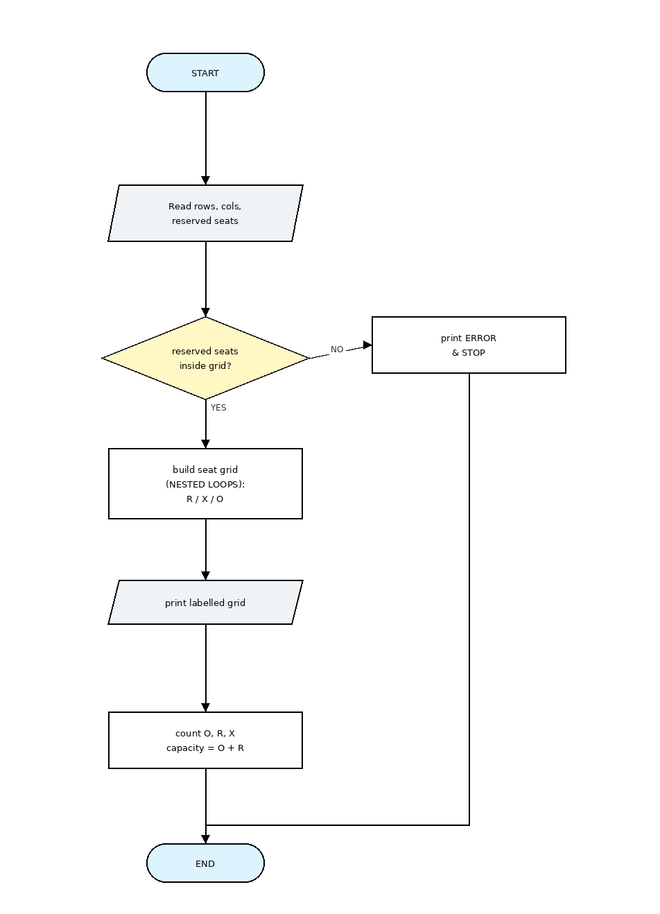

# Case Study 26 — Nested Loop Examination Seating Generator

## Problem statement

Generate an examination seating arrangement with row and column identifiers, reserved positions, alternate seating restrictions and a fixed classroom capacity, using nested loops.

## Objectives

Build the 6x8 seating grid with nested loops; apply the reserved-seat and alternate-spacing rules with conditionals; validate reserved seats before printing; count open, reserved and blocked positions from the nested list.

## Assumptions

Grid is 6 rows x 8 columns, numbered from 1 in the display. Reserved seats (2,3), (2,4), (5,7) are invigilator desks and override all other rules. In even rows (2, 4, 6) only even columns may be seated. Exam capacity = open + reserved seats. Data is hypothetical.

## Algorithm

```
1. START
2. SET ROWS=6, COLS=8, RESERVED=[(2,3),(2,4),(5,7)],
   ALT_ROWS=[2,4,6], ALT_BLOCKED=[1,3,5,7]
3. FOR each (r,c) in RESERVED DO
     IF r<1 OR r>ROWS OR c<1 OR c>COLS → print error, STOP
4. END FOR
5. SET seat ← empty nested list
6. FOR r ← 1 TO ROWS DO
     row ← []
     FOR c ← 1 TO COLS DO
        IF (r,c) ∈ RESERVED          → row.append("R")
        ELSE IF r ∈ ALT_ROWS AND c ∈ ALT_BLOCKED
                                      → row.append("X")
        ELSE                          → row.append("O")
     END FOR
     append row TO seat
7. END FOR
8. PRINT column headers C1..C8, then FOR each row print "Rn | cells"
9. COUNT O, R, X by nested iteration; capacity ← O + R
10. PRINT summary; also demo validation with an out-of-range seat
11. END
```

## Flowchart



## Pseudocode

```
BEGIN SEATING_GENERATOR

    ROWS ← 6 ; COLS ← 8
    RESERVED ← [(2,3), (2,4), (5,7)]
    ALT_ROWS ← [2,4,6] ; ALT_BLOCKED ← [1,3,5,7]

    FOR (r,c) IN RESERVED DO
        IF r ∉ [1..ROWS] OR c ∉ [1..COLS] THEN
            PRINT "reserved seat outside grid" ; STOP
    END FOR

    seat ← []
    FOR r ← 1 TO ROWS DO
        row ← []
        FOR c ← 1 TO COLS DO
            IF (r,c) IN RESERVED THEN              row ← row + "R"
            ELSE IF r IN ALT_ROWS AND c IN ALT_BLOCKED THEN
                row ← row + "X"
            ELSE
                row ← row + "O"
            END IF
        END FOR
        APPEND row TO seat
    END FOR

    PRINT headers
    FOR r ← 1 TO ROWS DO
        PRINT "R" + r + " |" + JOIN(seat[r−1], "  ")
    END FOR

    o ← 0 ; rcount ← 0 ; x ← 0
    FOR each row IN seat DO
        FOR each cell IN row DO
            IF cell = "O" THEN o ← o+1
            ELSE IF cell = "R" THEN rcount ← rcount+1
            ELSE x ← x+1
        END FOR
    END FOR

    PRINT "capacity = " + o + rcount
END
```

## Python source code

```python
"""
Case Study 26: Nested Loop Examination Seating Generator
--------------------------------------------------------
Syllabus: nested loops, conditional statements, lists, operators,
pattern / grid generation, input validation.
"""

# ---------------- Classroom configuration ----------------
ROWS = 6
COLS = 8
RESERVED = [(2, 3), (2, 4), (5, 7)]        # (row, col) 1-based, invigilator desks
ALT_ROWS = (2, 4, 6)                       # alternate rows keep only even columns
ALT_BLOCKED_COLS = (1, 3, 5, 7)            # odd columns blocked in those rows


def validate_reserved():
    """Check every reserved seat lies inside the classroom grid."""
    problems = []
    for r, c in RESERVED:
        if not (1 <= r <= ROWS and 1 <= c <= COLS):
            problems.append("reserved seat (%d,%d) is outside %dx%d grid" % (r, c, ROWS, COLS))
    return problems


def build_seating():
    """Nested list: 'O' open, 'R' reserved, 'X' blocked by alternate rule."""
    seat = []
    for r in range(1, ROWS + 1):
        row = []
        for c in range(1, COLS + 1):
            if (r, c) in RESERVED:
                row.append("R")
            elif r in ALT_ROWS and c in ALT_BLOCKED_COLS:
                row.append("X")
            else:
                row.append("O")
        seat.append(row)
    return seat


def print_seating(seat):
    print("     " + "  ".join("C%d" % c for c in range(1, COLS + 1)))
    print("     " + "-" * (COLS * 3 - 1))
    for r in range(ROWS):
        cells = "  ".join(seat[r][c] for c in range(COLS))
        print("R%-3d | %s" % (r + 1, cells))
    print("\n  Legend: O = open seat   R = reserved   X = blocked (alternate spacing)")


def count_seats(seat):
    o = r = x = 0
    for row in seat:                       # loop over nested list
        for cell in row:
            if cell == "O":
                o += 1
            elif cell == "R":
                r += 1
            else:
                x += 1
    return o, r, x


def main():
    print("=" * 60)
    print("  EXAMINATION SEATING ARRANGEMENT GENERATOR")
    print("=" * 60)

    problems = validate_reserved()
    if problems:
        print("VALIDATION ERRORS:")
        for p in problems:
            print("  - " + p)
        return

    seat = build_seating()
    print_seating(seat)

    o, r, x = count_seats(seat)
    print("\nSUMMARY")
    print("-" * 60)
    print("  Total grid positions : %d  (%d rows x %d cols)" % (ROWS * COLS, ROWS, COLS))
    print("  Open seats (O)       : %d" % o)
    print("  Reserved seats (R)   : %d" % r)
    print("  Blocked seats (X)    : %d" % x)
    print("  Exam capacity        : %d students" % (o + r))
    print("  Rows fully usable    : %d of %d" %
          (sum(1 for row in seat if "X" not in row), ROWS))

    # ---- demonstrate validation with a bad reserved seat ----
    print("\nVALIDATION DEMO (out-of-range reserved seat):")
    bad = (9, 2)
    if 1 <= bad[0] <= ROWS and 1 <= bad[1] <= COLS:
        print("  seat accepted")
    else:
        print("  ERROR: reserved seat (%d,%d) is outside %dx%d grid"
              % (bad[0], bad[1], ROWS, COLS))


if __name__ == "__main__":
    main()
```

## Test cases

Twelve automated checks: grid is 6x8; (2,3) and (5,7) marked R; odd columns of rows 2/4/6 blocked while reserved cells stay R; (1,1) stays open; the default reserved list validates; an out-of-range seat (9,2) is rejected; counts 34 open + 3 reserved + 11 blocked = 48. All pass (test_cases.py).

## Output screenshot


## Conclusion

Nested loops plus two simple rules produced a fully labelled seating chart, and validation caught an out-of-range reserved seat before any output. The counts account for all 48 positions, and three constants scale the layout to any classroom size.
