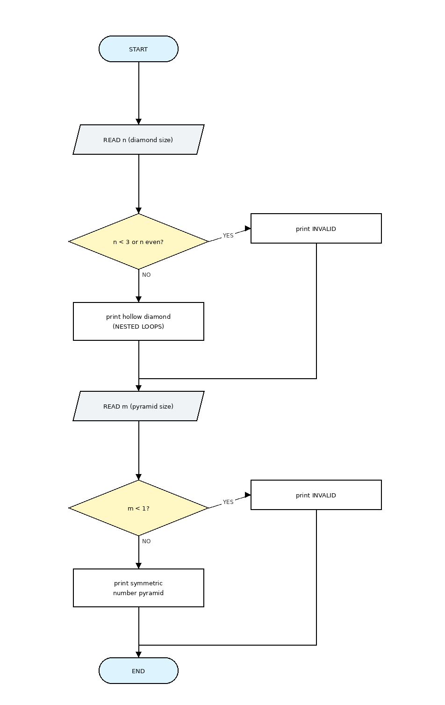
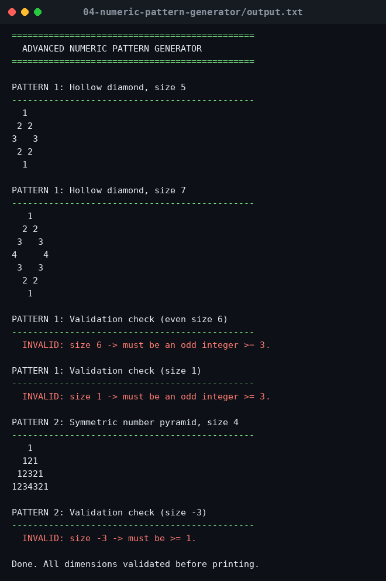

# Case Study 27 — Advanced Numeric Pattern Generator

## Problem statement

Produce a hollow diamond or a symmetric numerical pattern from a user-specified size, rejecting invalid dimensions and keeping the output carefully aligned.

## Objectives

Generate both patterns with nested loops; compute distance from the centre, row length and padding with operators; validate every dimension before printing; align rows with space padding.

## Assumptions

The diamond size must be an odd integer of at least 3 so a centre row exists; the pyramid size must be at least 1. Digits used are 1-9, so practical sizes do not exceed 9. Output is printed one row per line.

## Algorithm

```
1. START
2. READ n
3. IF n < 3 OR n is even → print "INVALID", go to step 12
4. mid ← n // 2
5. FOR i ← 0 TO n−1 DO
     5.1 dist ← |i − mid|
     5.2 digit ← mid − dist + 1
     5.3 row_len ← 2 × (mid − dist) + 1
     5.4 pad ← (n − row_len) // 2
     5.5 line ← ""
     5.6 FOR j ← 0 TO row_len−1 DO
           IF j = 0 OR j = row_len−1 → line ← line + digit
           ELSE                      → line ← line + " "
         END FOR
     5.7 PRINT spaces(pad) + line
6. END FOR
7. --- pyramid ---
8. READ m ; IF m < 1 → print "INVALID", go to step 12
9. FOR i ← 1 TO m DO
     line ← digits 1..i concatenated, then i−1..1
     PRINT spaces(m − i) + line
10. END FOR
11. PRINT "Done"
12. END
```

## Flowchart



## Pseudocode

```
BEGIN NUMERIC_PATTERN_GENERATOR

    FUNCTION hollow_diamond(n):
        IF n < 3 OR n MOD 2 = 0 THEN
            PRINT "INVALID: must be odd and >= 3"
            RETURN FALSE
        END IF
        mid ← n // 2
        FOR i ← 0 TO n−1 DO
            dist ← ABS(i − mid)
            digit ← mid − dist + 1
            row_len ← 2 × (mid − dist) + 1
            pad ← (n − row_len) // 2
            line ← ""
            FOR j ← 0 TO row_len−1 DO
                IF j = 0 OR j = row_len−1 THEN
                    line ← line + STRING(digit)
                ELSE
                    line ← line + " "
                END IF
            END FOR
            PRINT SPACES(pad) + line
        END FOR
        RETURN TRUE
    END FUNCTION

    FUNCTION number_pyramid(m):
        IF m < 1 THEN PRINT "INVALID" ; RETURN FALSE
        FOR i ← 1 TO m DO
            line ← ""
            FOR j ← 1 TO i     DO line ← line + STRING(j)
            FOR j ← i−1 DOWNTO 1 DO line ← line + STRING(j)
            PRINT SPACES(m − i) + line
        END FOR
        RETURN TRUE
    END FUNCTION

    CALL hollow_diamond(5) ; CALL hollow_diamond(7)
    CALL hollow_diamond(6)   → rejected
    CALL number_pyramid(4)   ; CALL number_pyramid(-3) → rejected
END
```

## Python source code

```python
"""
Case Study 27: Advanced Numeric Pattern Generator
--------------------------------------------------
Syllabus: nested loops, conditional statements, operators, pattern
generation, input validation, string formatting.
"""


def hollow_diamond(n):
    """Print a hollow diamond of height n (must be odd, >= 3)."""
    if n < 3 or n % 2 == 0:
        print("  INVALID: size %d -> must be an odd integer >= 3." % n)
        return False

    mid = n // 2
    for i in range(n):
        dist = abs(i - mid)
        digit = str(mid - dist + 1)
        row_len = 2 * (mid - dist) + 1
        pad = (n - row_len) // 2
        line = ""
        for j in range(row_len):
            if j == 0 or j == row_len - 1:
                line += digit
            else:
                line += " "
        print(" " * pad + line)
    return True


def number_pyramid(m):
    """Print a symmetric numeric pyramid of height m (must be >= 1)."""
    if m < 1:
        print("  INVALID: size %d -> must be >= 1." % m)
        return False
    for i in range(1, m + 1):
        line = ""
        for j in range(1, i + 1):
            line += str(j)
        for j in range(i - 1, 0, -1):
            line += str(j)
        print(" " * (m - i) + line)
    return True


def main():
    print("=" * 46)
    print("  ADVANCED NUMERIC PATTERN GENERATOR")
    print("=" * 46)

    print("\nPATTERN 1: Hollow diamond, size 5")
    print("-" * 46)
    hollow_diamond(5)

    print("\nPATTERN 1: Hollow diamond, size 7")
    print("-" * 46)
    hollow_diamond(7)

    print("\nPATTERN 1: Validation check (even size 6)")
    print("-" * 46)
    hollow_diamond(6)

    print("\nPATTERN 1: Validation check (size 1)")
    print("-" * 46)
    hollow_diamond(1)

    print("\nPATTERN 2: Symmetric number pyramid, size 4")
    print("-" * 46)
    number_pyramid(4)

    print("\nPATTERN 2: Validation check (size -3)")
    print("-" * 46)
    number_pyramid(-3)

    print("\nDone. All dimensions validated before printing.")


if __name__ == "__main__":
    main()
```

## Test cases

Nine automated checks: size 5 accepted with centre row '3   3' and exactly five rows; even size 6 and size 1 rejected; pyramid of size 4 ends with 1234321 and has a centred top row; negative size rejected; size 7 accepted. All pass (test_cases.py).

## Output screenshot



## Conclusion

Distance-from-centre arithmetic and space padding produced both patterns with no formatting libraries, and every invalid dimension was rejected with a clear message before any row was printed.
