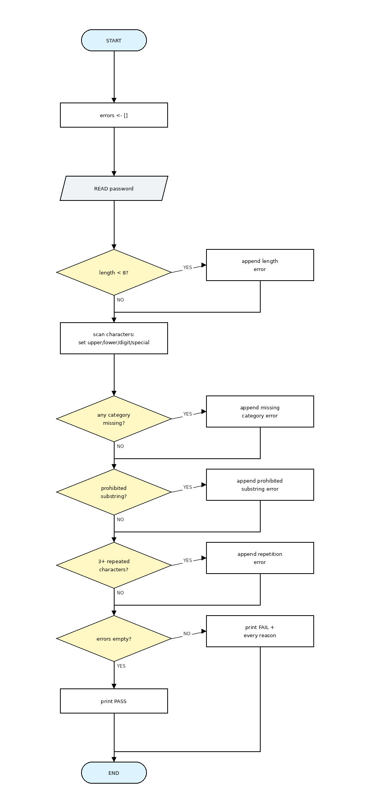

# Case Study 29 — Password Policy Validation Engine

## Problem statement

Evaluate sample passwords against minimum length, character-category, repetition and prohibited-substring rules, explaining every failed condition.

## Objectives

Scan strings character by character with loops; track the four character categories with flags; detect three-in-a-row repetitions; collect and report all failures, not just the first.

## Assumptions

Passwords are plain ASCII. Policy: at least 8 characters, at least one uppercase, one lowercase, one digit and one special character from !@#$%^&*()-_=+[]{};:,.<>?, no prohibited substring (password, 123456, admin, qwerty - case-insensitive), and no character repeated three times in a row.

## Algorithm

```
1. START
2. READ password
3. errors ← []
4. IF length < 8 → append "length below minimum"
5. SET upper=lower=digit=special ← false
6. FOR each character ch in password DO
     IF 'A'≤ch≤'Z' → upper ← true
     ELSE IF 'a'≤ch≤'z' → lower ← true
     ELSE IF '0'≤ch≤'9' → digit ← true
     ELSE IF ch ∈ SPECIALS → special ← true
7. END FOR
8. IF not upper  → append "missing uppercase"
   IF not lower  → append "missing lowercase"
   IF not digit  → append "missing digit"
   IF not special→ append "missing special character"
9. lower_pw ← password converted to lower case
10. FOR each word in PROHIBITED DO
      IF word is a substring of lower_pw → append "contains 'word'"
11. END FOR
12. run ← 1
13. FOR i ← 1 TO length−1 DO
      IF password[i] = password[i−1] THEN
           run ← run + 1 ; IF run ≥ 3 → append "3+ repeats" ; exit loop
      ELSE run ← 1
14. END FOR
15. IF errors empty → PRINT "PASS" ELSE PRINT "FAIL" + all errors
16. END
```

## Flowchart



## Pseudocode

```
BEGIN PASSWORD_VALIDATION

    MIN_LENGTH ← 8
    PROHIBITED ← ["password", "123456", "admin", "qwerty"]
    SPECIALS ← "!@#$%^&*()-_=+[]{};:,.<>?"

    FUNCTION validate(pw):
        errors ← []

        IF LENGTH(pw) < MIN_LENGTH THEN
            APPEND "length below minimum" TO errors

        upper ← FALSE ; lower ← FALSE ; digit ← FALSE ; special ← FALSE
        FOR each ch IN pw DO
            IF ch IN "A".."Z"      THEN upper ← TRUE
            ELSE IF ch IN "a".."z"  THEN lower ← TRUE
            ELSE IF ch IN "0".."9"  THEN digit ← TRUE
            ELSE IF ch IN SPECIALS  THEN special ← TRUE
        END FOR

        IF NOT upper   THEN APPEND "missing uppercase" TO errors
        IF NOT lower   THEN APPEND "missing lowercase" TO errors
        IF NOT digit   THEN APPEND "missing digit" TO errors
        IF NOT special THEN APPEND "missing special" TO errors

        low ← LOWERCASE(pw)
        FOR each word IN PROHIBITED DO
            IF word IS SUBSTRING OF low THEN
                APPEND "contains '" + word + "'" TO errors
        END FOR

        run ← 1
        FOR i ← 1 TO LENGTH(pw)−1 DO
            IF pw[i] = pw[i−1] THEN
                run ← run + 1
                IF run ≥ 3 THEN
                    APPEND "3+ identical characters in a row" TO errors
                    BREAK
                END IF
            ELSE
                run ← 1
            END IF
        END FOR

        RETURN errors
    END FUNCTION

    FOR each sample IN SAMPLES DO
        errs ← validate(sample)
        IF errs = [] THEN PRINT "PASS sample"
        ELSE PRINT "FAIL sample" + errs
    END FOR
END
```

## Python source code

```python
"""
Case Study 29: Password Policy Validation Engine
-------------------------------------------------
Syllabus: strings, string methods, conditional statements, loops,
operators, boolean logic, reporting failures.
"""

PROHIBITED = ["password", "123456", "admin", "qwerty"]
MIN_LENGTH = 8
SPECIALS = "!@#$%^&*()-_=+[]{};:,.<>?"


def has_repetition(pw, run_limit=3):
    """True if any character repeats `run_limit` times consecutively."""
    run = 1
    for i in range(1, len(pw)):
        if pw[i] == pw[i - 1]:
            run += 1
            if run >= run_limit:
                return True
        else:
            run = 1
    return False


def validate(pw):
    """Return a list of failed-condition messages (empty list => valid)."""
    errors = []

    if len(pw) < MIN_LENGTH:
        errors.append("length %d is below minimum %d" % (len(pw), MIN_LENGTH))

    has_upper = False
    has_lower = False
    has_digit = False
    has_special = False
    for ch in pw:
        if "A" <= ch <= "Z":
            has_upper = True
        elif "a" <= ch <= "z":
            has_lower = True
        elif "0" <= ch <= "9":
            has_digit = True
        elif ch in SPECIALS:
            has_special = True

    if not has_upper:
        errors.append("missing an uppercase letter (A-Z)")
    if not has_lower:
        errors.append("missing a lowercase letter (a-z)")
    if not has_digit:
        errors.append("missing a digit (0-9)")
    if not has_special:
        errors.append("missing a special character (%s)" % SPECIALS[:8] + "...")

    lower = pw.lower()
    for word in PROHIBITED:
        if word in lower:
            errors.append("contains prohibited substring '%s'" % word)

    if has_repetition(pw):
        errors.append("contains 3+ identical characters in a row")

    return errors


def main():
    samples = [
        "welcome",
        "Passw0rd",
        "Strong#Pass1",
        "aaabbbCCC123!",
        "admin@12345",
        "MyCampus#2026",
        "AAAAAAAAaaaa1111!",
    ]

    print("=" * 70)
    print("  PASSWORD POLICY VALIDATION ENGINE")
    print("=" * 70)
    print("Policy: length >= %d, upper+lower+digit+special, no prohibited" % MIN_LENGTH)
    print("substrings %s, no 3-in-a-row repeats." % PROHIBITED)
    print("-" * 70)

    passed = 0
    for pw in samples:
        errors = validate(pw)
        if not errors:
            passed += 1
            print("  [ PASS ] %-20s -> accepted" % pw)
        else:
            print("  [ FAIL ] %-20s -> %d problem(s)" % (pw, len(errors)))
            for e in errors:
                print("            * %s" % e)

    print("-" * 70)
    print("Result: %d of %d sample passwords satisfy the policy."
          % (passed, len(samples)))


if __name__ == "__main__":
    main()
```

## Test cases

Eleven automated checks: MyCampus#2026 accepted; short passwords and missing uppercase/digit/special each reported; 'admin' detected case-insensitively; repeats found in aaabbb but not in abcabc or aabbcc; several failures reported together; exactly 2 of the 7 samples accepted. All pass (test_cases.py).

## Output screenshot


## Conclusion

The engine reports every violated rule for each password - for example admin@12345 fails on both a missing uppercase letter and a prohibited substring. Category flags and a run counter keep the logic to a single pass over the string.
