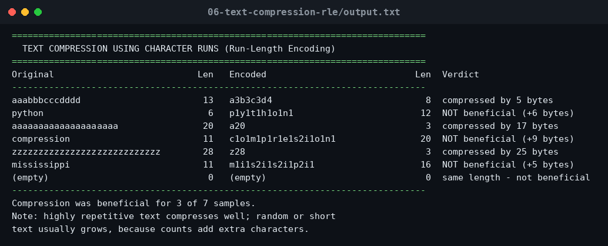

# Case Study 35 — Text Compression Using Character Runs

Repository: [Python-Activity-Based-Learning](../README.md)

## 1. Problem Statement

**Encode a string by grouping consecutive repeated characters** (Run-Length
Encoding) and **compare original and encoded lengths**, including cases where
encoding is **not beneficial**.

Encoding rule: each maximal run of a character becomes `<char><count>`, e.g.
`aaabbbcccdddd → a3b3c3d4`.

For every sample the system reports both lengths and a verdict:

- `compressed by N bytes` — encoded shorter than original
- `NOT beneficial (+N bytes` — encoded longer than original
- `same length - not beneficial` — equal lengths

## 2. Objectives

- Traverse a **string** with a loop, grouping consecutive equal characters.
- Build the encoded string using **string concatenation** and **operators**.
- Compare **lengths** to decide whether compression helped.
- Handle edge cases (empty string, single characters, alternating characters).
- Demonstrate *when* a simple algorithm helps and when it backfires.

## 3. Assumptions

- Input strings contain **letters only** (no digits), so counts embedded in
  the encoding are never ambiguous.
- Count of a run is written in decimal with no separator (safe under the
  alphabetic-input assumption).
- "Beneficial" means strictly shorter; equal length is reported as
  not beneficial.
- Empty input encodes to empty output.

## 4. Algorithm

```
1. START
2. READ text
3. IF text is empty → encoded ← "" ; goto step 9
4. parts ← []; count ← 1
5. FOR i ← 1 TO length(text)−1 DO
     5.1 IF text[i] = text[i−1] → count ← count + 1
     5.2 ELSE → append text[i−1] + count TO parts ; count ← 1
6. END FOR
7. append text[last] + count TO parts
8. encoded ← join(parts)
9. PRINT text, len(text), encoded, len(encoded)
10. IF len(encoded) < len(text)   → "compressed by N bytes"
    ELSE IF len(encoded) > len(text) → "NOT beneficial (+N bytes)"
    ELSE → "same length - not beneficial"
11. END
```

## 5. Flowchart

```
              ┌─────────┐
              │  START  │
              └────┬────┘
                   ▼
            ┌─────────────┐
            │ READ text   │
            └──────┬──────┘
                   ▼
          ┌─────────────────┐     YES   ┌────────────────┐
          │ text empty ?    ├──────────►│ encoded ← ""   │
          └──────┬──────────┘           └───────┬────────┘
              NO  ▼                             │
     ┌───────────────────────┐                  │
     │ parts ← []            │                  │
     │ count ← 1             │                  │
     └──────────┬────────────┘                  │
                ▼                               │
   ┌─────────────────────────┐◄───────┐         │
   │ FOR i ← 1 TO len−1      │        │         │
   └────────────┬────────────┘        │         │
                ▼                     │         │
   ┌─────────────────────────┐        │         │
   │ text[i] = text[i−1] ?   │        │         │
   │  YES → count + 1        │        │         │
   │  NO  → parts += char+cnt│        │         │
   │        count ← 1        │        │         │
   └────────────┬────────────┘        │         │
                └──────────┬──────────┘         │
                           ▼                    │
   ┌─────────────────────────┐                  │
   │ parts += last char+count│                  │
   │ encoded ← JOIN(parts)   │                  │
   └────────────┬────────────┘                  │
                └──────────────┬────────────────┘
                               ▼
              ┌─────────────────────────────┐
              │ len(enc) < len(text)?       │
              │  YES → "compressed by N"    │
              │  NO  → "NOT beneficial"     │
              └──────────────┬──────────────┘
                             ▼
                      ┌─────────────┐
                      │    END      │
                      └─────────────┘
```

## 6. Pseudocode

```
BEGIN TEXT_COMPRESSION

    FUNCTION encode(text):
        IF text = "" THEN RETURN ""
        parts ← [] ; count ← 1
        FOR i ← 1 TO LENGTH(text)−1 DO
            IF text[i] = text[i−1] THEN
                count ← count + 1
            ELSE
                APPEND text[i−1] + STRING(count) TO parts
                count ← 1
            END IF
        END FOR
        APPEND text[LAST] + STRING(count) TO parts
        RETURN JOIN(parts, "")
    END FUNCTION

    FOR each s IN SAMPLES DO
        enc ← encode(s)
        IF LENGTH(enc) < LENGTH(s)      THEN PRINT "compressed by", diff
        ELSE IF LENGTH(enc) > LENGTH(s) THEN PRINT "NOT beneficial", extra
        ELSE                               PRINT "same length"
    END FOR

    PRINT summary count of beneficial cases
END
```

## 7. Python Source Code

Complete, runnable source: **[`solution.py`](./solution.py)**

Key logic (the encoder):

```python
def encode(text):
    """Run-length encode: consecutive runs become <char><count>."""
    if text == "":
        return ""
    parts = []
    count = 1
    for i in range(1, len(text)):
        if text[i] == text[i - 1]:
            count += 1
        else:
            parts.append(text[i - 1] + str(count))
            count = 1
    parts.append(text[-1] + str(count))
    return "".join(parts)
```

Run: `python3 solution.py`

## 8. Test Cases

Automated suite: [`test_cases.py`](./test_cases.py) — **10/10 passing**.

| ID | Input | Expected | Actual | Status |
|----|-------|----------|--------|--------|
| TC-01 | `aaabbbccc` | `a3b3c3` | `a3b3c3` | PASS |
| TC-02 | `python` (all single) | `p1y1t1h1o1n1` | matched | PASS |
| TC-03 | 20 × `a` | `a20` (3 chars) | `a20` | PASS |
| TC-04 | `""` (empty) | `""` | `""` | PASS |
| TC-05 | `ababab` (alternating) | `a1b1a1b1a1b1` | matched | PASS |
| TC-06 | 20 × `a` | encoded shorter than original | 3 < 20 | PASS |
| TC-07 | `python` | encoded longer ("not beneficial") | 12 > 6 | PASS |
| TC-08 | `aabb` | equal length → not beneficial | 4 = 4 | PASS |
| TC-09 | `mississippi` | `m1i1s2i1s2i1p2i1` | matched | PASS |
| TC-10 | `aaabbbcccdddd` (13) | encoded length 8 | 8 | PASS |

## 9. Output



Full text output: [`output.txt`](./output.txt)

```text
Original                         Len   Encoded                          Len   Verdict
aaabbbcccdddd                     13   a3b3c3d4                          8   compressed by 5 bytes
python                             6   p1y1t1h1o1n1                     12   NOT beneficial (+6 bytes)
aaaaaaaaaaaaaaaaaaaa              20   a20                                3   compressed by 17 bytes
compression                       11   c1o1m1p1r1e1s2i1o1n1              20   NOT beneficial (+9 bytes)
zzzzzzzzzzzzzzzzzzzzzzzzzzzz      28   z28                                3   compressed by 25 bytes
mississippi                       11   m1i1s2i1s2i1p2i1                  16   NOT beneficial (+5 bytes)
(empty)                            0   (empty)                            0   same length - not beneficial

Compression was beneficial for 3 of 7 samples.
```

## 10. Conclusion

A single loop with a run counter implements classic Run-Length Encoding in
under 15 lines. The length comparison made the algorithm's behaviour explicit:
it compressed highly repetitive text (`28 z's → z28`, saving 25 bytes) but
*expanded* ordinary text like `compression` (+9 bytes) because every isolated
character grows to two characters. This case study demonstrates both sides of
algorithmic trade-offs — the same code that is optimal for repetitive data is
sub-optimal for random data — and all boundary cases (empty, alternating,
single-run inputs) are locked down by the automated tests.
