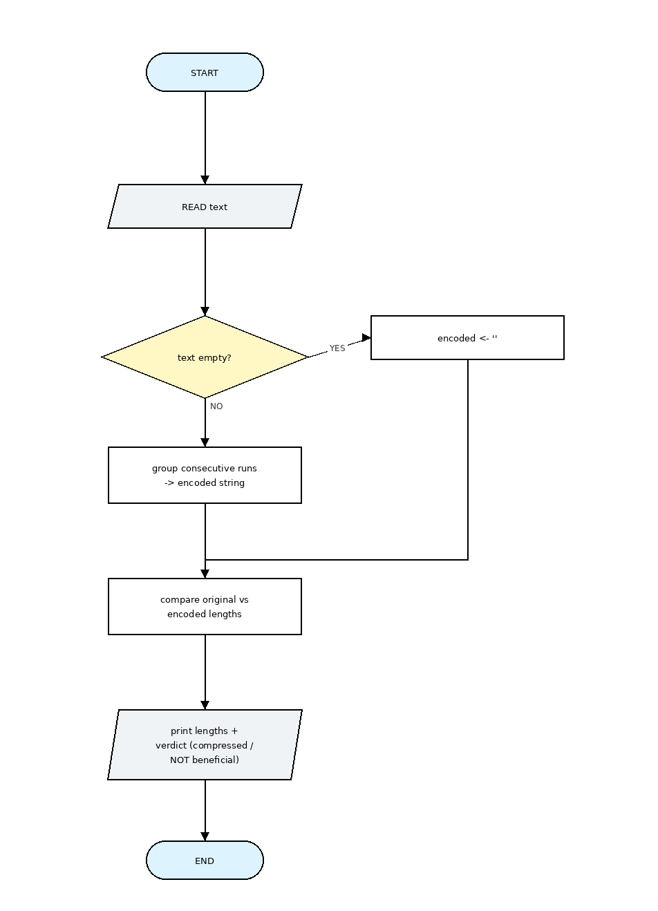

# Case Study 35 — Text Compression Using Character Runs

## Problem statement

Encode a string by grouping consecutive repeated characters (run-length encoding) and compare original and encoded lengths, including cases where the encoding is not beneficial.

## Objectives

Traverse the string with a loop and group equal runs; build the encoded string with concatenation; compare lengths to decide whether compression helped; handle empty, single-run and alternating inputs.

## Assumptions

Inputs contain letters only, so counts embedded in the encoding are never ambiguous. Each run becomes <char><count>. Beneficial means strictly shorter; equal length counts as not beneficial. Empty input encodes to empty output.

## Algorithm

```
1. START
2. READ text
3. IF text is empty → encoded ← "" ; goto step 9
4. parts ← []; count ← 1
5. FOR i ← 1 TO length(text)−1 DO
     5.1 IF text[i] = text[i−1] → count ← count + 1
     5.2 ELSE → append text[i−1] + count TO parts ; count ← 1
6. END FOR
7. append text[last] + count TO parts
8. encoded ← join(parts)
9. PRINT text, len(text), encoded, len(encoded)
10. IF len(encoded) < len(text)   → "compressed by N bytes"
    ELSE IF len(encoded) > len(text) → "NOT beneficial (+N bytes)"
    ELSE → "same length - not beneficial"
11. END
```

## Flowchart



## Pseudocode

```
BEGIN TEXT_COMPRESSION

    FUNCTION encode(text):
        IF text = "" THEN RETURN ""
        parts ← [] ; count ← 1
        FOR i ← 1 TO LENGTH(text)−1 DO
            IF text[i] = text[i−1] THEN
                count ← count + 1
            ELSE
                APPEND text[i−1] + STRING(count) TO parts
                count ← 1
            END IF
        END FOR
        APPEND text[LAST] + STRING(count) TO parts
        RETURN JOIN(parts, "")
    END FUNCTION

    FOR each s IN SAMPLES DO
        enc ← encode(s)
        IF LENGTH(enc) < LENGTH(s)      THEN PRINT "compressed by", diff
        ELSE IF LENGTH(enc) > LENGTH(s) THEN PRINT "NOT beneficial", extra
        ELSE                               PRINT "same length"
    END FOR

    PRINT summary count of beneficial cases
END
```

## Python source code

```python
"""
Case Study 35: Text Compression Using Character Runs (RLE)
-----------------------------------------------------------
Syllabus: strings, loops, conditional statements, operators,
lists, length comparisons.
Assumption: input strings contain letters only (no digits), so the
count part of the encoding is never ambiguous.
"""


def encode(text):
    """Run-length encode: consecutive runs become <char><count>."""
    if text == "":
        return ""
    parts = []
    count = 1
    for i in range(1, len(text)):
        if text[i] == text[i - 1]:
            count += 1
        else:
            parts.append(text[i - 1] + str(count))
            count = 1
    parts.append(text[-1] + str(count))
    return "".join(parts)


def main():
    samples = [
        "aaabbbcccdddd",
        "python",
        "aaaaaaaaaaaaaaaaaaaa",
        "compression",
        "zzzzzzzzzzzzzzzzzzzzzzzzzzzz",
        "mississippi",
        "",
    ]

    print("=" * 78)
    print("  TEXT COMPRESSION USING CHARACTER RUNS (Run-Length Encoding)")
    print("=" * 78)
    print("%-30s %7s   %-30s %7s  %s" %
          ("Original", "Len", "Encoded", "Len", "Verdict"))
    print("-" * 78)

    beneficial = 0
    for s in samples:
        enc = encode(s)
        if len(enc) < len(s):
            verdict = "compressed by %d bytes" % (len(s) - len(enc))
            beneficial += 1
        elif len(enc) > len(s):
            verdict = "NOT beneficial (+%d bytes)" % (len(enc) - len(s))
        else:
            verdict = "same length - not beneficial"
        print("%-30s %7d   %-30s %7d  %s" %
              (s if s else "(empty)", len(s), enc if enc else "(empty)", len(enc), verdict))

    print("-" * 78)
    print("Compression was beneficial for %d of %d samples." %
          (beneficial, len(samples)))
    print("Note: highly repetitive text compresses well; random or short")
    print("text usually grows, because counts add extra characters.")


if __name__ == "__main__":
    main()
```

## Test cases

Ten automated checks: aaabbbccc to a3b3c3; python to p1y1t1h1o1n1; twenty a's to a20; empty stays empty; ababab does not merge; compression helps repetitive text but grows python and aabb (equal length); mississippi to m1i1s2i1s2i1p2i1; 13 characters compress to 8. All pass (test_cases.py).

## Output screenshot


## Conclusion

A single loop with a run counter implements RLE in a few lines, and the length comparison shows both sides of the trade-off: repetitive text shrinks sharply while ordinary text grows. All boundary cases are locked down by the tests.
