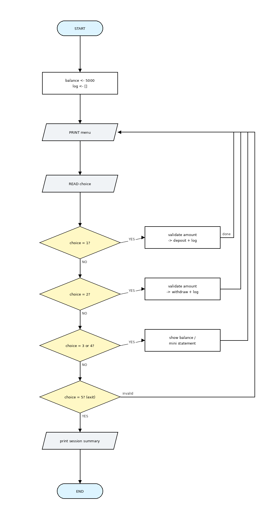
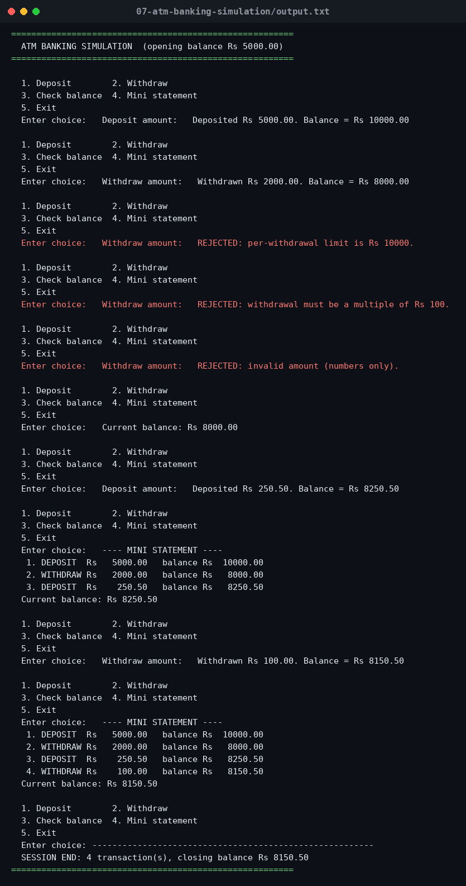

# Case Study 38 — ATM Menu-Driven Banking Simulation

Repository: [Python-Activity-Based-Learning](../README.md)

## 1. Problem Statement

Implement **repeated menu operations** for deposits, withdrawals, balance
inquiries, and transaction summaries, with **validation** and specified
account limits.

Rules enforced:

- Opening balance: ₹5,000
- Deposit: must be positive and ≤ ₹1,00,000 per transaction
- Withdrawal: positive, **multiple of ₹100**, ≤ ₹10,000 per transaction, and
  must leave **at least ₹1,000** in the account
- Non-numeric input is rejected without crashing
- Every accepted transaction is appended to a **list-based mini statement**
  with its running balance
- The menu loops until the user chooses Exit, then prints a session summary

## 2. Objectives

- Drive a program with a **menu loop** (`while True` + choice dispatch).
- Validate inputs using **conditional statements** and operators.
- Maintain account state and a **list of transactions** (tuples).
- **Unpack** each log tuple when printing the statement.
- Handle bad input gracefully (try/except around numeric conversion).

## 3. Assumptions

- Single account, single currency (₹), no interest or fees.
- Amounts may be entered with decimals for deposits; withdrawals must be
  whole multiples of 100.
- The mini statement shows at most the transactions of the current session.
- Menu choices are read as strings; anything other than 1–5 is rejected.
- Demo input is scripted in `demo_input.txt` for reproducible output.

## 4. Algorithm

```
1. START
2. balance ← 5000 ; log ← []
3. LOOP:
   3.1 PRINT menu (1 Deposit, 2 Withdraw, 3 Balance, 4 Statement, 5 Exit)
   3.2 READ choice
   3.3 IF choice = 1:
         READ amount ; if non-numeric → reject
         IF amount ≤ 0 or > 100000 → reject
         ELSE balance += amount ; log.append(("DEPOSIT", amount, balance))
   3.4 IF choice = 2:
         READ amount ; if non-numeric → reject
         IF amount ≤ 0                → reject
         ELSE IF amount % 100 ≠ 0     → reject
         ELSE IF amount > 10000       → reject
         ELSE IF balance − amount < 1000 → reject
         ELSE balance −= amount ; log.append(("WITHDRAW", amount, balance))
   3.5 IF choice = 3 → PRINT balance
   3.6 IF choice = 4 → FOR each (kind, amt, bal) in log: PRINT row
   3.7 IF choice = 5 → PRINT session summary ; BREAK
   3.8 ELSE → PRINT "unknown option"
4. END LOOP
5. END
```

## 5. Flowchart



Text version:

```
                ┌─────────┐
                │  START  │
                └────┬────┘
                     ▼
          ┌─────────────────────┐
          │ balance ← 5000      │
          │ log ← []            │
          └──────────┬──────────┘
                     ▼
        ┌────────────────────────┐◄───────────────┐
        │ PRINT menu             │                │
        │ READ choice            │                │
        └────────────┬───────────┘                │
                     ▼                            │
        ┌────────────────────────┐                │
        │ choice = 1 ?           │──YES──► validate & deposit
        └────────────┬───────────┘                │
                  NO ▼                            │
        ┌────────────────────────┐                │
        │ choice = 2 ?           │──YES──► validate (×100, ≤10000,
        └────────────┬───────────┘           ≥1000 left) & withdraw
                  NO ▼                            │
        ┌────────────────────────┐                │
        │ choice = 3 ?           │──YES──► PRINT balance
        └────────────┬───────────┘                │
                  NO ▼                            │
        ┌────────────────────────┐                │
        │ choice = 4 ?           │──YES──► PRINT mini statement
        └────────────┬───────────┘           (FOR each log row)
                  NO ▼                            │
        ┌────────────────────────┐                │
        │ choice = 5 ?           │──YES──► PRINT summary → END
        └────────────┬───────────┘                │
                  NO ▼                            │
        ┌────────────────────────┐                │
        │ PRINT "unknown option" │────────────────┘
        └────────────────────────┘
```

## 6. Pseudocode

```
BEGIN ATM_SIMULATION

    balance ← 5000 ; log ← []
    MIN_BALANCE ← 1000 ; MAX_WITHDRAW ← 10000 ; MAX_DEPOSIT ← 100000

    FUNCTION deposit(amount):
        IF amount ≤ 0 OR amount > MAX_DEPOSIT THEN RETURN "REJECTED"
        balance ← balance + amount
        APPEND ("DEPOSIT", amount, balance) TO log
        RETURN "accepted"
    END FUNCTION

    FUNCTION withdraw(amount):
        IF amount ≤ 0                    THEN RETURN "REJECTED"
        IF amount MOD 100 ≠ 0            THEN RETURN "REJECTED: multiple of 100"
        IF amount > MAX_WITHDRAW         THEN RETURN "REJECTED: limit"
        IF balance − amount < MIN_BALANCE THEN RETURN "REJECTED: min balance"
        balance ← balance − amount
        APPEND ("WITHDRAW", amount, balance) TO log
        RETURN "accepted"
    END FUNCTION

    REPEAT
        PRINT menu
        READ choice
        CASE choice OF
            "1": READ amount → deposit(amount)   [catch non-numeric]
            "2": READ amount → withdraw(amount)  [catch non-numeric]
            "3": PRINT balance
            "4": FOR (kind, amt, bal) IN log DO PRINT row END FOR
            "5": PRINT summary ; EXIT loop
            DEFAULT: PRINT "unknown option"
        END CASE
    UNTIL choice = "5"
END
```

## 7. Python Source Code

Complete, runnable source: **[`solution.py`](./solution.py)**

Key logic (withdrawal validation):

```python
def do_withdraw(state, amount):
    if amount <= 0:
        return False, "REJECTED: withdrawal must be positive."
    if amount % 100 != 0:
        return False, "REJECTED: withdrawal must be a multiple of Rs 100."
    if amount > MAX_WITHDRAW:
        return False, "REJECTED: per-withdrawal limit is Rs %d." % MAX_WITHDRAW
    if state["balance"] - amount < MIN_BALANCE:
        return False, ("REJECTED: would drop below minimum balance Rs %d "
                       "(balance Rs %.2f)." % (MIN_BALANCE, state["balance"]))
    state["balance"] -= amount
    state["log"].append(("WITHDRAW", amount, state["balance"]))
    return True, "Withdrawn Rs %.2f. Balance = Rs %.2f" % (amount, state["balance"])
```

Run (interactive): `python3 solution.py`
Run (scripted demo): `python3 solution.py < demo_input.txt`

## 8. Test Cases

Automated suite: [`test_cases.py`](./test_cases.py) — **10/10 passing**.

| ID | Input | Expected | Actual | Status |
|----|-------|----------|--------|--------|
| TC-01 | deposit ₹1,500 (bal 5000) | accepted, balance 6500, 1 log row | 6500, 1 row | PASS |
| TC-02 | deposit −100 | rejected, balance unchanged | rejected, 5000 | PASS |
| TC-03 | deposit ₹2,00,000 | rejected (> ₹1,00,000 limit) | rejected | PASS |
| TC-04 | withdraw ₹2,000 (bal 8000) | accepted, balance 6000 | 6000 | PASS |
| TC-05 | withdraw ₹250 | rejected (not multiple of 100) | rejected + message | PASS |
| TC-06 | withdraw ₹15,000 | rejected (> ₹10,000 limit) | rejected + "limit" | PASS |
| TC-07 | withdraw ₹2,500 (bal 3000) | rejected (would go below ₹1,000) | rejected | PASS |
| TC-08 | withdraw ₹2,000 (bal 3000) | accepted, balance = ₹1,000 exactly | accepted | PASS |
| TC-09 | `float("abc")` | non-numeric input caught | `ValueError` caught | PASS |
| TC-10 | 3 mixed transactions | log has 3 rows, running balance correct | 3 rows, 5400 | PASS |

## 9. Output



Full text output: [`output.txt`](./output.txt) · scripted input: [`demo_input.txt`](./demo_input.txt)

```text
  Enter choice:   ---- MINI STATEMENT ----
   1. DEPOSIT  Rs   5000.00   balance Rs  10000.00
   2. WITHDRAW Rs   2000.00   balance Rs   8000.00
   3. DEPOSIT  Rs    250.50   balance Rs   8250.50
   4. WITHDRAW Rs    100.00   balance Rs   8150.50
  Current balance: Rs 8150.50

  SESSION END: 4 transaction(s), closing balance Rs 8150.50
```

The scripted demo also exercises rejections: withdraw ₹12,000 (over limit),
withdraw ₹9,999 (not a multiple of 100), and a non-numeric amount — each is
rejected with a message while the balance stays intact.

## 10. Conclusion

The ATM simulation shows how a `while` menu loop plus guarded transaction
functions produce a robust interactive program: all five rules (positivity,
multiple-of-100, per-txn ceiling, minimum balance, numeric parsing) are
enforced *before* any state changes, and the transaction log doubles as the
mini statement through simple tuple unpacking. The scripted demo and the 10
automated tests together prove that valid operations update state exactly as
expected while every invalid operation leaves the balance untouched.
