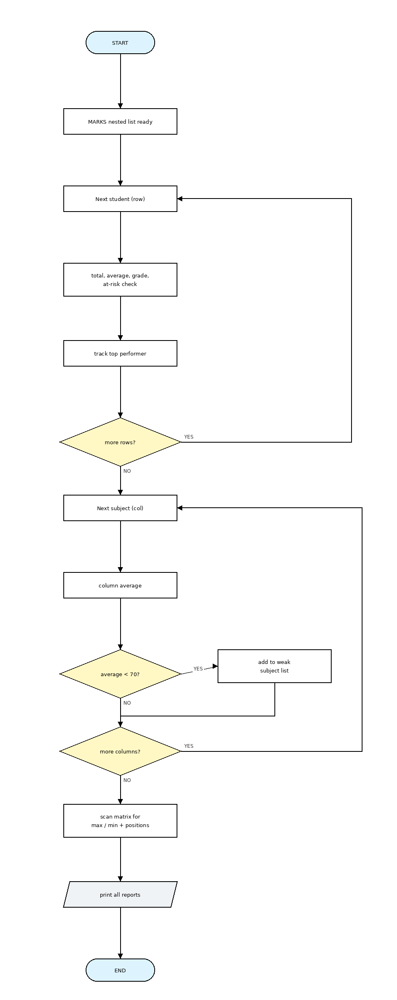

# Case Study 42 — Student Marks Matrix Analysis

## Problem statement

Analyse a matrix of student marks across subjects: compute row-wise and column-wise statistics, identify the top performer and detect subjects with low average performance.

## Objectives

Store the marks as a nested list; compute row totals, averages and grades with loops; compute column averages the same way; track the maximum and minimum marks with their positions.

## Assumptions

Five students x five subjects, every mark an integer 0-100, averages divide by 5. Grades: A at 85+, B at 70+, C at 55+, else D. A subject is weak when its average is below 70; a student is at risk below an average of 60. Data is hypothetical.

## Algorithm

```
1. START
2. READ nested list MARKS[5][5], STUDENTS[5], SUBJECTS[5]
3. PRINT header + FOR r ← 0 TO 4: print row r with its average
4. FOR r ← 0 TO 4 DO
     total ← Σ MARKS[r][c] for c = 0..4
     avg ← total / 5
     grade ← avg ≥ 85 ? A : avg ≥ 70 ? B : avg ≥ 55 ? C : D
     flag at-risk if avg < 60
     track max total → top performer
5. END FOR
6. FOR c ← 0 TO 4 DO
     total ← Σ MARKS[r][c] for r = 0..4
     avg ← total / 5
     IF avg < 70 → add SUBJECTS[c] to weak list
7. END FOR
8. FOR r, c over whole matrix → track highest and lowest marks + positions
9. PRINT row-wise table, top performer, column averages, extremes, weak list
10. END
```

## Flowchart



## Pseudocode

```
BEGIN MARKS_MATRIX_ANALYSIS

    FOR r ← 0 TO 4 DO
        total ← 0
        FOR c ← 0 TO 4 DO total ← total + MARKS[r][c] END FOR
        avg ← total / 5
        IF avg ≥ 85      THEN grade ← "A"
        ELSE IF avg ≥ 70  THEN grade ← "B"
        ELSE IF avg ≥ 55  THEN grade ← "C"
        ELSE                  grade ← "D"
        IF avg < 60 THEN PRINT "AT RISK"
        IF total > best_total THEN best_total ← total ; best ← r
        PRINT STUDENTS[r], total, avg, grade
    END FOR

    weak ← []
    FOR c ← 0 TO 4 DO
        total ← 0
        FOR r ← 0 TO 4 DO total ← total + MARKS[r][c] END FOR
        avg ← total / 5
        IF avg < 70 THEN APPEND SUBJECTS[c] TO weak
        PRINT SUBJECTS[c], avg
    END FOR

    high ← 0 ; low ← 100
    FOR r ← 0 TO 4 DO
        FOR c ← 0 TO 4 DO
            IF MARKS[r][c] > high THEN high ← MARKS[r][c] ; hi ← (r,c)
            IF MARKS[r][c] < low  THEN low  ← MARKS[r][c] ; lo ← (r,c)
        END FOR
    END FOR

    PRINT "Top performer:", STUDENTS[best]
    PRINT "Highest / lowest marks and weak subjects"
END
```

## Python source code

```python
"""
Case Study 42: Student Marks Matrix Analysis
--------------------------------------------
Syllabus: nested lists, conditional statements, loops, operators,
row-wise / column-wise statistics, max/min with position.
"""

SUBJECTS = ["Maths", "Physics", "Chemistry", "English", "CS"]
STUDENTS = ["Ananya", "Bharat", "Chitra", "Deepak", "Fatima"]

# rows = students, columns = subjects
MARKS = [
    [82, 76, 90, 71, 85],
    [55, 48, 62, 70, 58],
    [74, 69, 71, 66, 80],
    [61, 57, 64, 59, 66],
    [91, 88, 94, 87, 96],
]

WEAK_SUBJECT_AVERAGE = 70.0
AT_RISK_AVERAGE = 60.0


def grade_of(avg):
    if avg >= 85:
        return "A (Distinction)"
    if avg >= 70:
        return "B (First Class)"
    if avg >= 55:
        return "C (Second Class)"
    return "D (Third Class)"


def main():
    # ---------- display the matrix ----------
    print("=" * 74)
    print("  STUDENT MARKS MATRIX ANALYSIS")
    print("=" * 74)
    header = "%-9s" % "Student" + "".join("%10s" % s for s in SUBJECTS) + "%9s" % "Avg"
    print(header)
    print("-" * 74)
    for r in range(len(STUDENTS)):
        row = MARKS[r]
        avg = sum(row) / len(row)
        print("%-9s" % STUDENTS[r] + "".join("%10d" % m for m in row) + "%9.2f" % avg)
    print("-" * 74)

    # ---------- row-wise statistics ----------
    print("\nROW-WISE (per student):")
    best_total = -1
    best_index = -1
    for r in range(len(STUDENTS)):
        total = sum(MARKS[r])
        avg = total / len(MARKS[r])
        status = "AT RISK" if avg < AT_RISK_AVERAGE else "ok"
        print("  %-9s total=%3d  avg=%5.2f  grade=%-18s %s"
              % (STUDENTS[r], total, avg, grade_of(avg), status))
        if total > best_total:
            best_total = total
            best_index = r
    print("  -> Top performer: %s (%d marks)" % (STUDENTS[best_index], best_total))

    # ---------- column-wise statistics ----------
    print("\nCOLUMN-WISE (per subject):")
    weak = []
    for c in range(len(SUBJECTS)):
        total = 0
        for r in range(len(STUDENTS)):
            total += MARKS[r][c]
        avg = total / len(STUDENTS)
        flag = ""
        if avg < WEAK_SUBJECT_AVERAGE:
            flag = "  << WEAK SUBJECT"
            weak.append(SUBJECTS[c])
        print("  %-10s average = %5.2f%s" % (SUBJECTS[c], avg, flag))

    # ---------- extremes ----------
    high = -1
    low = 101
    hi_pos = lo_pos = (0, 0)
    for r in range(len(STUDENTS)):
        for c in range(len(SUBJECTS)):
            if MARKS[r][c] > high:
                high = MARKS[r][c]
                hi_pos = (r, c)
            if MARKS[r][c] < low:
                low = MARKS[r][c]
                lo_pos = (r, c)
    print("\nEXTRAMES:")
    print("  Highest: %d (%s in %s)" % (high, STUDENTS[hi_pos[0]], SUBJECTS[hi_pos[1]]))
    print("  Lowest : %d (%s in %s)" % (low, STUDENTS[lo_pos[0]], SUBJECTS[lo_pos[1]]))
    print("  Weak subjects (avg < %.0f): %s" %
          (WEAK_SUBJECT_AVERAGE, ", ".join(weak) if weak else "none"))


if __name__ == "__main__":
    main()
```

## Test cases

Fourteen automated checks: 5x5 shape; row totals 404 and 456; Maths average 72.6; Physics 67.6 flagged as the only weak subject; Fatima top performer; lowest mark 48; only Bharat at risk; grade boundaries at 90/75/60/40; all marks within 0-100. All pass (test_cases.py).

## Output screenshot


## Conclusion

The same nested list supports both traversal directions: row loops give per-student grades and risk flags, column loops isolated Physics as the only weak subject, and a full scan found 96 (Fatima, CS) and 48 (Bharat, Physics).
