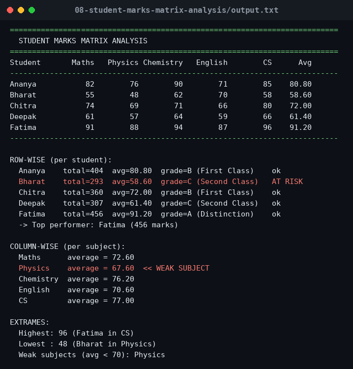

# Case Study 42 — Student Marks Matrix Analysis

Repository: [Python-Activity-Based-Learning](../README.md)

## 1. Problem Statement

Analyse a **matrix of student marks across subjects**, calculate **row-wise and
column-wise statistics**, identify **top performers**, and detect **subjects
with low average performance**.

Data: a nested list with 5 students (rows) × 5 subjects (columns):

```
            Maths  Physics  Chem  English  CS
Ananya        82      76     90     71     85
Bharat        55      48     62     70     58
Chitra        74      69     71     66     80
Deepak        61      57     64     59     66
Fatima        91      88     94     87     96
```

Reports required:

1. Row-wise: total, average, grade (A ≥ 85, B ≥ 70, C ≥ 55, else D), at-risk
   flag (average < 60).
2. Column-wise: subject averages; flag **weak subjects** (average < 70).
3. Top performer (highest total) and the highest / lowest single marks with
   their positions.

## 2. Objectives

- Store two-dimensional data in a **nested list**.
- Compute row statistics with loops + `sum`/`len` operators.
- Compute column statistics with a nested loop (column index outer logic).
- Track max/min **with their positions** using variables.
- Apply **conditional statements** for grades, weak-subject and at-risk flags.

## 3. Assumptions

- Every mark is an integer in 0–100.
- Each student has exactly 5 subject marks; averages divide by 5.
- Weak-subject threshold: column average < 70.
- At-risk threshold: student average < 60.
- Grade boundaries are inclusive at the lower limit (85/70/55/40).
- All data is hypothetical.

## 4. Algorithm

```
1. START
2. READ nested list MARKS[5][5], STUDENTS[5], SUBJECTS[5]
3. PRINT header + FOR r ← 0 TO 4: print row r with its average
4. FOR r ← 0 TO 4 DO
     total ← Σ MARKS[r][c] for c = 0..4
     avg ← total / 5
     grade ← avg ≥ 85 ? A : avg ≥ 70 ? B : avg ≥ 55 ? C : D
     flag at-risk if avg < 60
     track max total → top performer
5. END FOR
6. FOR c ← 0 TO 4 DO
     total ← Σ MARKS[r][c] for r = 0..4
     avg ← total / 5
     IF avg < 70 → add SUBJECTS[c] to weak list
7. END FOR
8. FOR r, c over whole matrix → track highest and lowest marks + positions
9. PRINT row-wise table, top performer, column averages, extremes, weak list
10. END
```

## 5. Flowchart

```
              ┌─────────┐
              │  START  │
              └────┬────┘
                   ▼
      ┌─────────────────────────┐
      │ MARKS nested list ready │
      └────────────┬────────────┘
                   ▼
      ┌─────────────────────────┐◄────────────┐
      │ FOR r ← 0 TO 4 (rows)   │             │
      └────────────┬────────────┘             │
                   ▼                          │
      ┌─────────────────────────┐             │
      │ total = Σ row           │             │
      │ avg = total / 5         │             │
      │ grade by thresholds     │             │
      │ avg < 60 → AT RISK      │             │
      │ track max total         │             │
      └────────────┬────────────┘             │
                   └──────────┬───────────────┘
                              ▼
      ┌─────────────────────────┐◄────────────┐
      │ FOR c ← 0 TO 4 (cols)   │             │
      └────────────┬────────────┘             │
                   ▼                          │
      ┌─────────────────────────┐             │
      │ total = Σ column        │             │
      │ avg = total / 5         │             │
      │ avg < 70 → WEAK SUBJECT │             │
      └────────────┬────────────┘             │
                   └──────────┬───────────────┘
                              ▼
      ┌─────────────────────────┐
      │ scan whole matrix for   │
      │ max / min + positions   │
      └────────────┬────────────┘
                   ▼
      ┌─────────────────────────┐
      │ PRINT all four reports  │
      └────────────┬────────────┘
                   ▼
            ┌─────────────┐
            │    END      │
            └─────────────┘
```

## 6. Pseudocode

```
BEGIN MARKS_MATRIX_ANALYSIS

    FOR r ← 0 TO 4 DO
        total ← 0
        FOR c ← 0 TO 4 DO total ← total + MARKS[r][c] END FOR
        avg ← total / 5
        IF avg ≥ 85      THEN grade ← "A"
        ELSE IF avg ≥ 70  THEN grade ← "B"
        ELSE IF avg ≥ 55  THEN grade ← "C"
        ELSE                  grade ← "D"
        IF avg < 60 THEN PRINT "AT RISK"
        IF total > best_total THEN best_total ← total ; best ← r
        PRINT STUDENTS[r], total, avg, grade
    END FOR

    weak ← []
    FOR c ← 0 TO 4 DO
        total ← 0
        FOR r ← 0 TO 4 DO total ← total + MARKS[r][c] END FOR
        avg ← total / 5
        IF avg < 70 THEN APPEND SUBJECTS[c] TO weak
        PRINT SUBJECTS[c], avg
    END FOR

    high ← 0 ; low ← 100
    FOR r ← 0 TO 4 DO
        FOR c ← 0 TO 4 DO
            IF MARKS[r][c] > high THEN high ← MARKS[r][c] ; hi ← (r,c)
            IF MARKS[r][c] < low  THEN low  ← MARKS[r][c] ; lo ← (r,c)
        END FOR
    END FOR

    PRINT "Top performer:", STUDENTS[best]
    PRINT "Highest / lowest marks and weak subjects"
END
```

## 7. Python Source Code

Complete, runnable source: **[`solution.py`](./solution.py)**

Key logic (column averages + weak detection):

```python
for c in range(len(SUBJECTS)):
    total = 0
    for r in range(len(STUDENTS)):
        total += MARKS[r][c]
    avg = total / len(STUDENTS)
    flag = ""
    if avg < WEAK_SUBJECT_AVERAGE:          # 70
        flag = "  << WEAK SUBJECT"
        weak.append(SUBJECTS[c])
    print("  %-10s average = %5.2f%s" % (SUBJECTS[c], avg, flag))
```

Run: `python3 solution.py`

## 8. Test Cases

Automated suite: [`test_cases.py`](./test_cases.py) — **14/14 passing**.

| ID | Input | Expected | Actual | Status |
|----|-------|----------|--------|--------|
| TC-01 | matrix shape | 5 × 5 | 5 × 5 | PASS |
| TC-02a | Ananya row | total 404 | 404 | PASS |
| TC-02b | Fatima row | total 456 | 456 | PASS |
| TC-03 | Maths column | average 72.6 | 72.6 | PASS |
| TC-04 | Physics column | average 67.6 (< 70 → weak) | 67.6, weak | PASS |
| TC-05 | all columns | only Physics below 70 | `["Physics"]` | PASS |
| TC-06 | row totals | top = Fatima | Fatima | PASS |
| TC-07 | whole matrix | lowest single mark 48 | 48 | PASS |
| TC-08 | student averages | only Bharat < 60 (at risk) | `["Bharat"]` | PASS |
| TC-09a | grade(90) | `A (Distinction)` | matched | PASS |
| TC-09b | grade(75) | `B (First Class)` | matched | PASS |
| TC-09c | grade(60) | `C (Second Class)` | matched | PASS |
| TC-09d | grade(40) | `D (Third Class)` | matched | PASS |
| TC-10 | all marks | within 0–100 | all in range | PASS |

## 9. Output



Full text output: [`output.txt`](./output.txt)

```text
ROW-WISE (per student):
  Ananya    total=404  avg=80.80  grade=A (Distinction)   ok
  Bharat    total=293  avg=58.60  grade=D (Third Class)   AT RISK
  Chitra    total=360  avg=72.00  grade=B (First Class)   ok
  Deepak    total=307  avg=61.40  grade=C (Second Class)  ok
  Fatima    total=456  avg=91.20  grade=A (Distinction)   ok
  -> Top performer: Fatima (456 marks)

COLUMN-WISE (per subject):
  Maths      average = 72.60
  Physics    average = 67.60  << WEAK SUBJECT
  Chemistry  average = 76.20
  English    average = 70.60
  CS         average = 77.00

EXTRAMES:
  Highest: 96 (Fatima in CS)
  Lowest : 48 (Bharat in Physics)
  Weak subjects (avg < 70): Physics
```

## 10. Conclusion

The nested-list matrix supports both traversal directions with the same data
structure: row loops give per-student totals, grades and risk flags, while
column loops expose subject averages and correctly isolated Physics (67.6) as
the only weak subject. Max/min scanning with stored positions pinpointed 96
(Fatima, CS) and 48 (Bharat, Physics) without any extra libraries. All 14
assertions confirm the statistics, classifications and threshold flags —
showing that disciplined indexing into nested lists is sufficient for
full-fledged matrix analytics.
