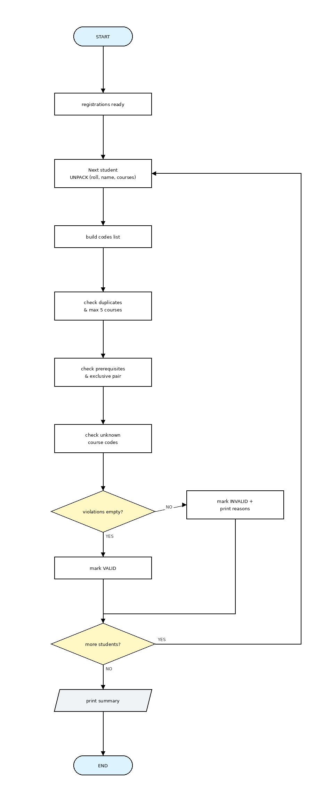

# Case Study 64 — Tuple-Based Course Registration Validation

## Problem statement

Represent course registrations as tuples, identify duplicate registrations and invalid course combinations, and determine which students violate the supplied rules.

## Objectives

Model each registration as a nested tuple; unpack outer and inner tuples while validating; detect duplicates with tuple counting; enforce the enrolment cap, prerequisites, exclusive pair and known-code rules; report every violation per student.

## Assumptions

Each record is (roll, name, ((code, title), ...)). Rules: at most 5 courses, no duplicate codes, CS201 requires CS101 and CS301 requires CS201 in the same list, PHY101 and PHY102 cannot be combined, and only CS101/CS201/CS301/MATH101/PHY101/PHY102/ENG101 are known. Data is hypothetical.

## Algorithm

```
1. START
2. READ REGISTRATIONS: list of (roll, name, ((code,title),...))
3. FOR each student DO
   3.1 UNPACK student → roll, name, courses
   3.2 codes ← [code for (code,title) in courses]
   3.3 violations ← []
   3.4 FOR each c in codes:
         IF codes.count(c) > 1 → append "duplicate c" (once)
   3.5 IF len(courses) > 5 → append "too many courses"
   3.6 FOR each c in codes:
         IF c ∈ PREREQ AND PREREQ[c] ∉ codes → append "missing prerequisite"
   3.7 FOR each (a,b) in EXCLUSIVE:
         IF a ∈ codes AND b ∈ codes → append "exclusive pair"
   3.8 FOR each c in codes:
         IF c ∉ KNOWN → append "unknown code"
   3.9 IF violations empty → VALID else INVALID (+ print each)
4. END FOR
5. PRINT summary: count valid vs invalid, list violators
6. END
```

## Flowchart



## Pseudocode

```
BEGIN COURSE_REGISTRATION_VALIDATION

    MAX_COURSES ← 5
    PREREQ ← { "CS201"→"CS101", "CS301"→"CS201" }
    EXCLUSIVE ← [ ("PHY101","PHY102") ]

    FUNCTION validate(student):
        (roll, name, courses) ← student
        codes ← []
        FOR (code, title) IN courses DO
            APPEND code TO codes
        END FOR
        violations ← []

        FOR c IN codes DO
            IF codes.count(c) > 1 AND "duplicate c" ∉ violations THEN
                APPEND "duplicate '" + c + "'" TO violations
        END FOR

        IF LENGTH(courses) > MAX_COURSES THEN
            APPEND "too many courses" TO violations

        FOR c IN codes DO
            IF c IN PREREQ AND PREREQ[c] NOT IN codes THEN
                APPEND "missing prerequisite ... " TO violations
        END FOR

        FOR (a,b) IN EXCLUSIVE DO
            IF a IN codes AND b IN codes THEN
                APPEND "mutually exclusive pair" TO violations
        END FOR

        FOR c IN codes DO
            IF c NOT IN KNOWN THEN APPEND "unknown code" TO violations
        END FOR

        RETURN violations
    END FUNCTION

    FOR each student IN REGISTRATIONS DO
        v ← validate(student)
        PRINT student, "VALID" or "INVALID", v
    END FOR
    PRINT summary
END
```

## Python source code

```python
"""
Case Study 64: Tuple-Based Course Registration Validation
---------------------------------------------------------
Syllabus: tuples, tuple operations, tuple unpacking, nested tuples,
lists, conditional statements, loops, duplicate detection.
"""

MAX_COURSES = 5
PREREQ = {"CS201": "CS101", "CS301": "CS201"}     # course -> required course
MUTUALLY_EXCLUSIVE = [("PHY101", "PHY102")]       # pick only one

# (roll, name, ((code, title), ...))
REGISTRATIONS = [
    ("R01", "Ananya", (
        ("CS101", "Intro to Programming"),
        ("MATH101", "Calculus"),
        ("PHY101", "Physics I"),
    )),
    ("R02", "Bharat", (
        ("CS101", "Intro to Programming"),
        ("CS101", "Intro to Programming"),       # duplicate
        ("CS201", "Data Structures"),
    )),
    ("R03", "Chitra", (
        ("CS201", "Data Structures"),            # missing prerequisite CS101
        ("MATH101", "Calculus"),
    )),
    ("R04", "Deepak", (
        ("CS101", "Intro to Programming"),
        ("PHY101", "Physics I"),
        ("PHY102", "Physics II"),                # exclusive pair
        ("MATH101", "Calculus"),
        ("CS101", "Intro to Programming"),       # duplicate + 6th course
        ("ENG101", "Technical English"),
    )),
    ("R05", "Fatima", (
        ("CS101", "Intro to Programming"),
        ("CS201", "Data Structures"),
        ("MATH101", "Calculus"),
        ("PHY101", "Physics I"),
        ("ENG101", "Technical English"),
    )),
    ("R06", "Gopal", (
        ("CS301", "Algorithms"),                 # missing CS201 (and CS101)
        ("MATH101", "Calculus"),
    )),
]


def validate(student):
    """Return list of rule violations for one registration tuple."""
    roll, name, courses = student          # tuple unpacking
    codes = []
    for code, title in courses:            # unpacking each inner tuple
        codes.append(code)

    violations = []

    # rule 1: no duplicate course codes
    for c in codes:
        if codes.count(c) > 1 and ("duplicate '%s'" % c) not in violations:
            violations.append("duplicate '%s'" % c)

    # rule 2: at most MAX_COURSES courses
    if len(courses) > MAX_COURSES:
        violations.append("enrolled in %d courses (max %d)" % (len(courses), MAX_COURSES))

    # rule 3: prerequisites must also be registered
    for c in codes:
        if c in PREREQ and PREREQ[c] not in codes:
            msg = "missing prerequisite %s for %s" % (PREREQ[c], c)
            if msg not in violations:
                violations.append(msg)

    # rule 4: mutually exclusive pairs
    for a, b in MUTUALLY_EXCLUSIVE:
        if a in codes and b in codes:
            violations.append("mutually exclusive pair %s + %s" % (a, b))

    # rule 5: every course code must be a known code
    known = {"CS101", "CS201", "CS301", "MATH101", "PHY101", "PHY102", "ENG101"}
    for c in codes:
        if c not in known:
            violations.append("unknown course code '%s'" % c)

    return violations


def main():
    print("=" * 74)
    print("  TUPLE-BASED COURSE REGISTRATION VALIDATION")
    print("=" * 74)
    print("Rules: max %d courses, no duplicates, prerequisites satisfied," % MAX_COURSES)
    print("exclusive pairs not combined, only known course codes.")
    print("-" * 74)

    violators = []
    for student in REGISTRATIONS:
        roll, name, courses = student
        codes = [c for c, t in courses]
        violations = validate(student)
        status = "VALID" if not violations else "INVALID"
        print("  %s (%s) - %d course(s): %s"
              % (roll, name, len(courses), ", ".join(codes)))
        print("      -> %s" % status)
        for v in violations:
            print("         * %s" % v)
        if violations:
            violators.append((roll, name))

    print("-" * 74)
    print("Summary: %d valid, %d violating student(s)."
          % (len(REGISTRATIONS) - len(violators), len(violators)))
    if violators:
        print("Students violating rules:")
        for roll, name in violators:
            print("   - %s %s" % (roll, name))


if __name__ == "__main__":
    main()
```

## Test cases

Eleven automated checks: R01 and R05 valid; R02 flagged for duplicate CS101; R03 for the missing CS101 prerequisite; R04 for the exclusive pair, six courses and a duplicate; R06 for the missing CS201 prerequisite; tuple structure intact; totals 2 valid / 4 invalid of 6. All pass (test_cases.py).

## Output screenshot


## Conclusion

Nested tuples proved a natural record shape: unpacking gives instant access to roll, name and courses, and all five rules fire independently - R04 accumulates three separate violations in one report.
