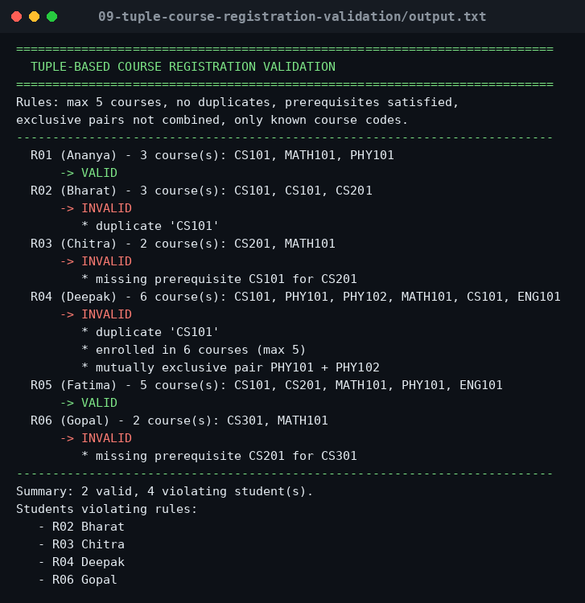

# Case Study 64 — Tuple-Based Course Registration Validation

Repository: [Python-Activity-Based-Learning](../README.md)

## 1. Problem Statement

Represent **course registrations as tuples**, identify **duplicate registrations
and invalid course combinations**, and determine **students whose selections
violate supplied rules**.

Data shape (nested tuples):

```python
(roll, name, ((code, title), (code, title), ...))
```

Rules enforced:

1. **No duplicate** course codes in one registration.
2. At most **5 courses** per student.
3. **Prerequisites**: `CS201` requires `CS101`; `CS301` requires `CS201`
   (both must appear in the same registration).
4. **Mutually exclusive pair**: `PHY101` and `PHY102` cannot both be taken.
5. Only **known course codes** may appear: CS101, CS201, CS301, MATH101,
   PHY101, PHY102, ENG101.

## 2. Objectives

- Model hierarchical records with **nested tuples**.
- Use **tuple operations**: `len()`, iteration, membership, `.count()`.
- **Unpack** outer and inner tuples while validating.
- Detect duplicates and rule violations with loops and conditionals.
- Report per-student verdicts and a violator summary.

## 3. Assumptions

- Course codes are unique identifiers; titles are informational.
- Prerequisites mean "registered in the same semester list".
- A student with zero violations is VALID; one or more → INVALID with all
  violations listed (not just the first).
- Six sample registrations cover every rule at least once.
- Data is hypothetical.

## 4. Algorithm

```
1. START
2. READ REGISTRATIONS: list of (roll, name, ((code,title),...))
3. FOR each student DO
   3.1 UNPACK student → roll, name, courses
   3.2 codes ← [code for (code,title) in courses]
   3.3 violations ← []
   3.4 FOR each c in codes:
         IF codes.count(c) > 1 → append "duplicate c" (once)
   3.5 IF len(courses) > 5 → append "too many courses"
   3.6 FOR each c in codes:
         IF c ∈ PREREQ AND PREREQ[c] ∉ codes → append "missing prerequisite"
   3.7 FOR each (a,b) in EXCLUSIVE:
         IF a ∈ codes AND b ∈ codes → append "exclusive pair"
   3.8 FOR each c in codes:
         IF c ∉ KNOWN → append "unknown code"
   3.9 IF violations empty → VALID else INVALID (+ print each)
4. END FOR
5. PRINT summary: count valid vs invalid, list violators
6. END
```

## 5. Flowchart

```
                ┌─────────┐
                │  START  │
                └────┬────┘
                     ▼
       ┌──────────────────────────┐
       │ REGISTRATIONS ready      │
       └────────────┬─────────────┘
                    ▼
     ┌──────────────────────────────┐◄─────────────┐
     │ FOR each (roll,name,courses) │              │
     └────────────┬─────────────────┘              │
                  ▼                                │
     ┌──────────────────────────┐                  │
     │ UNPACK + build codes list│                  │
     │ violations ← []          │                  │
     └────────────┬─────────────┘                  │
                  ▼                                │
     ┌──────────────────────────┐                  │
     │ duplicates? too many?    │──YES──► append   │
     │ missing prerequisite?    │──YES──► append   │
     │ exclusive pair?          │──YES──► append   │
     │ unknown code?            │──YES──► append   │
     └────────────┬─────────────┘                  │
                  ▼                                │
     ┌──────────────────────────┐                  │
     │ violations empty?        │                  │
     │  YES → VALID             │                  │
     │  NO  → INVALID + list    │                  │
     └────────────┬─────────────┘                  │
                  └──────────┬─────────────────────┘
                             ▼
               ┌──────────────────────────┐
               │ PRINT summary: counts,   │
               │ list of violators        │
               └────────────┬─────────────┘
                            ▼
                     ┌─────────────┐
                     │    END      │
                     └─────────────┘
```

## 6. Pseudocode

```
BEGIN COURSE_REGISTRATION_VALIDATION

    MAX_COURSES ← 5
    PREREQ ← { "CS201"→"CS101", "CS301"→"CS201" }
    EXCLUSIVE ← [ ("PHY101","PHY102") ]

    FUNCTION validate(student):
        (roll, name, courses) ← student
        codes ← []
        FOR (code, title) IN courses DO
            APPEND code TO codes
        END FOR
        violations ← []

        FOR c IN codes DO
            IF codes.count(c) > 1 AND "duplicate c" ∉ violations THEN
                APPEND "duplicate '" + c + "'" TO violations
        END FOR

        IF LENGTH(courses) > MAX_COURSES THEN
            APPEND "too many courses" TO violations

        FOR c IN codes DO
            IF c IN PREREQ AND PREREQ[c] NOT IN codes THEN
                APPEND "missing prerequisite ... " TO violations
        END FOR

        FOR (a,b) IN EXCLUSIVE DO
            IF a IN codes AND b IN codes THEN
                APPEND "mutually exclusive pair" TO violations
        END FOR

        FOR c IN codes DO
            IF c NOT IN KNOWN THEN APPEND "unknown code" TO violations
        END FOR

        RETURN violations
    END FUNCTION

    FOR each student IN REGISTRATIONS DO
        v ← validate(student)
        PRINT student, "VALID" or "INVALID", v
    END FOR
    PRINT summary
END
```

## 7. Python Source Code

Complete, runnable source: **[`solution.py`](./solution.py)**

Key logic (unpacking + rule checks):

```python
def validate(student):
    roll, name, courses = student              # tuple unpacking
    codes = []
    for code, title in courses:                # unpack inner tuples
        codes.append(code)
    violations = []

    for c in codes:                            # duplicates
        if codes.count(c) > 1 and ("duplicate '%s'" % c) not in violations:
            violations.append("duplicate '%s'" % c)

    if len(courses) > MAX_COURSES:             # over-enrolment
        violations.append("enrolled in %d courses (max %d)" % (len(courses), MAX_COURSES))

    for c in codes:                            # prerequisites
        if c in PREREQ and PREREQ[c] not in codes:
            msg = "missing prerequisite %s for %s" % (PREREQ[c], c)
            if msg not in violations:
                violations.append(msg)

    for a, b in MUTUALLY_EXCLUSIVE:            # exclusive pair
        if a in codes and b in codes:
            violations.append("mutually exclusive pair %s + %s" % (a, b))
    ...
    return violations
```

Run: `python3 solution.py`

## 8. Test Cases

Automated suite: [`test_cases.py`](./test_cases.py) — **11/11 passing**.

| ID | Input | Expected | Actual | Status |
|----|-------|----------|--------|--------|
| TC-01 | R01 (3 clean courses) | no violations | `[]` | PASS |
| TC-02 | R02 (CS101 twice) | duplicate reported | "duplicate 'CS101'" | PASS |
| TC-03 | R03 (CS201 w/o CS101) | missing prerequisite CS101 | reported | PASS |
| TC-04 | R04 (PHY101+PHY102) | exclusive pair reported | reported | PASS |
| TC-05 | R04 (6 courses) | exceeds max 5 | "max 5" reported | PASS |
| TC-06 | R04 duplicate | duplicate also reported | reported | PASS |
| TC-07 | R05 (valid 5 courses) | no violations | `[]` | PASS |
| TC-08 | R06 (CS301 w/o CS201) | missing CS201 for CS301 | reported | PASS |
| TC-09 | record structure | tuple of (str,str,tuple-of-pairs) | structure matched | PASS |
| TC-10 | all 6 registrations | 2 valid / 4 invalid | 2 / 4 | PASS |
| TC-11 | inner items | every course is a 2-tuple | all 2-tuples | PASS |

## 9. Output



Full text output: [`output.txt`](./output.txt)

```text
  R01 (Ananya) - 3 course(s): CS101, MATH101, PHY101
      -> VALID
  R02 (Bharat) - 3 course(s): CS101, CS101, CS201
      -> INVALID
         * duplicate 'CS101'
  R03 (Chitra) - 2 course(s): CS201, MATH101
      -> INVALID
         * missing prerequisite CS101 for CS201
  R04 (Deepak) - 6 course(s): CS101, PHY101, PHY102, MATH101, CS101, ENG101
      -> INVALID
         * duplicate 'CS101'
         * enrolled in 6 courses (max 5)
         * mutually exclusive pair PHY101 + PHY102
  R05 (Fatima) - 5 course(s): CS101, CS201, MATH101, PHY101, ENG101
      -> VALID
  R06 (Gopal) - 2 course(s): CS301, MATH101
      -> INVALID
         * missing prerequisite CS201 for CS301

Summary: 2 valid, 4 violating student(s).
```

## 10. Conclusion

Nested tuples proved to be a natural, immutable representation for registration
records: unpacking the outer tuple gives instant access to roll, name and the
course tuple, and unpacking each inner pair yields code and title without any
library support. All five supplied rules — duplicates, enrolment cap,
prerequisites, exclusive pairs and known-code checks — fire independently, as
shown by R04 which accumulates three separate violations in one report. The
suite confirms 2 valid / 4 invalid classifications, demonstrating thorough
validation through tuple operations, `.count()`, membership tests and loops.
