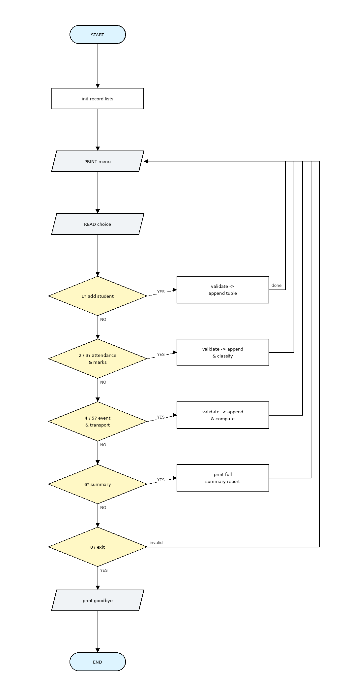
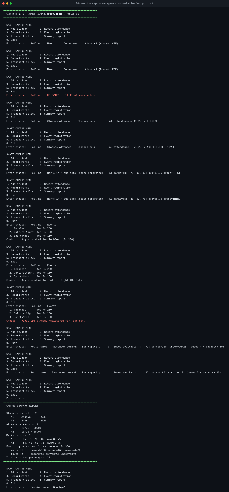

# Case Study 100 — Comprehensive Smart Campus Management Simulation

## Problem statement

Develop a menu-driven program that integrates student records, attendance, marks, event registration, resource allocation and summary reporting using conditional statements, loops, strings, lists, tuples and tuple unpacking.

## Objectives

Combine every syllabus topic in one menu loop; store records as tuples in lists and unpack them for reporting; validate each input before mutating state; compute revenue and unserved-passenger totals with loops.

## Assumptions

Data lives in memory only and starts empty each run. Attendance eligibility is 75%; grades are FIRST 75+, SECOND 60+, THIRD 40+, else FAIL. Marks are integers 0-100 in four subjects. Events cost Rs 200 / Rs 150 / Rs 100 and cannot be booked twice. The bus fleet has at most 6 buses; served = min(demand, buses x capacity). Sample input is scripted in demo_input.txt.

## Algorithm

```
1. START
2. students ← [] ; attendance ← [] ; marks_records ← []
   event_regs ← [] ; route_stats ← []
3. LOOP:
   3.1 PRINT menu ; READ choice
   3.2 CASE choice:
     "1": READ roll, name, dept
          IF empty or duplicate roll → REJECT
          ELSE students.append((roll, name, dept))
     "2": READ roll, present, total
          IF unknown roll or invalid numbers → REJECT
          ELSE append (roll, present, total);
               pct = present/total×100 ; flag ≥ 75 %
     "3": READ roll, 4 marks
          IF unknown roll, ≠4 marks, or out of 0–100 → REJECT
          ELSE append (roll, marks); avg; grade FIRST/SECOND/THIRD/FAIL
     "4": READ roll, event choice
          IF unknown roll / bad choice / already registered → REJECT
          ELSE append (roll, event_name, fee)
     "5": READ route, demand, capacity, buses
          IF invalid values or buses > 6 → REJECT
          ELSE served = min(demand, buses×capacity);
               append (route, demand, capacity, buses)
     "6": FOR each student tuple: unpack & PRINT
          revenue = Σ fees ; unserved = Σ (demand − served)
          PRINT all aggregates
     "0": PRINT goodbye ; BREAK
     DEFAULT: REJECT unknown option
4. END LOOP
5. END
```

## Flowchart



## Pseudocode

```
BEGIN SMART_CAMPUS_SIMULATION

    students ← [] ; attendance ← [] ; marks_records ← []
    event_regs ← [] ; route_stats ← []
    EVENTS ← [("TechFest",200), ("CulturalNight",150), ("SportsMeet",100)]
    TOTAL_BUSES ← 6

    REPEAT
        PRINT menu
        READ choice
        CASE choice OF
            "1": READ roll, name, dept
                 IF roll = "" OR name = "" OR roll EXISTS THEN REJECT
                 ELSE APPEND (roll, name, dept) TO students

            "2": READ roll, present, total
                 IF roll UNKNOWN OR total ≤ 0 OR present ∉ [0..total] THEN REJECT
                 ELSE APPEND (roll, present, total) TO attendance
                      pct ← present × 100 / total
                      PRINT eligibility (≥ 75 %)

            "3": READ roll, marks(4)
                 IF roll UNKNOWN OR count ≠ 4 OR any mark ∉ [0..100] THEN REJECT
                 ELSE APPEND (roll, marks) TO marks_records
                      avg ← Σ marks / 4
                      grade ← FIRST / SECOND / THIRD / FAIL

            "4": READ roll, choice
                 IF roll UNKNOWN OR choice invalid OR already registered THEN REJECT
                 ELSE (name, fee) ← EVENTS[choice−1]
                      APPEND (roll, name, fee) TO event_regs

            "5": READ route, demand, capacity, buses
                 IF invalid OR buses > TOTAL_BUSES THEN REJECT
                 ELSE served ← MIN(demand, buses × capacity)
                      APPEND (route, demand, capacity, buses) TO route_stats

            "6": FOR (roll,name,dept) IN students DO PRINT END FOR
                 revenue ← Σ fee  (FOR (roll,ev,fee) IN event_regs)
                 unserved ← Σ (demand − MIN(demand, buses×capacity))
                 PRINT totals

            "0": PRINT "Session ended" ; EXIT
            DEFAULT: REJECT
        END CASE
    UNTIL choice = "0"
END
```

## Python source code

```python
"""
Case Study 100: Comprehensive Smart Campus Management Simulation
----------------------------------------------------------------
Syllabus: menu-driven loops, conditional statements, strings, lists,
nested lists, tuples, tuple unpacking, operators, validation.
"""

# ---------------- global state (lists / tuples) ----------------
students = []        # (roll, name, dept)
attendance = []      # (roll, present, total)
marks_records = []   # (roll, [m1, m2, m3, m4])
event_regs = []      # (roll, event_name, fee)
route_stats = []     # (route, demand, capacity, buses_available)

EVENTS = [("TechFest", 200), ("CulturalNight", 150), ("SportsMeet", 100)]
TOTAL_BUSES = 6


def find_student(roll):
    for s in students:
        if s[0] == roll:
            return s
    return None


def add_student():
    # Validate the roll BEFORE reading further fields, so a rejected
    # entry never consumes inputs meant for the next menu operation.
    roll = input("  Roll no: ").strip().upper()
    if not roll:
        print("  REJECTED: roll is required.")
        return
    if find_student(roll) is not None:
        print("  REJECTED: roll %s already exists." % roll)
        return
    name = input("  Name   : ").strip()
    if not name:
        print("  REJECTED: name is required.")
        return
    dept = input("  Department: ").strip().upper()
    students.append((roll, name, dept))
    print("  Added %s (%s, %s)." % (roll, name, dept))


def record_attendance():
    roll = input("  Roll no: ").strip().upper()
    if find_student(roll) is None:
        print("  REJECTED: unknown roll %s." % roll)
        return
    try:
        present = int(input("  Classes attended: ").strip())
        total = int(input("  Classes held     : ").strip())
    except ValueError:
        print("  REJECTED: numbers only.")
        return
    if total <= 0 or present < 0 or present > total:
        print("  REJECTED: invalid attendance values.")
        return
    attendance.append((roll, present, total))
    pct = present * 100.0 / total
    verdict = "ELIGIBLE" if pct >= 75 else "NOT ELIGIBLE (<75%)"
    print("  %s attendance = %.1f%% -> %s" % (roll, pct, verdict))


def record_marks():
    roll = input("  Roll no: ").strip().upper()
    if find_student(roll) is None:
        print("  REJECTED: unknown roll %s." % roll)
        return
    raw = input("  Marks in 4 subjects (space separated): ").strip().split()
    if len(raw) != 4:
        print("  REJECTED: exactly 4 marks required.")
        return
    try:
        marks = [int(x) for x in raw]
    except ValueError:
        print("  REJECTED: marks must be integers.")
        return
    for m in marks:
        if m < 0 or m > 100:
            print("  REJECTED: marks must be within 0-100.")
            return
    marks_records.append((roll, marks))
    avg = sum(marks) / len(marks)
    if avg >= 75:
        grade = "FIRST"
    elif avg >= 60:
        grade = "SECOND"
    elif avg >= 40:
        grade = "THIRD"
    else:
        grade = "FAIL"
    print("  %s marks=%s avg=%.2f grade=%s" % (roll, marks, avg, grade))


def register_event():
    roll = input("  Roll no: ").strip().upper()
    if find_student(roll) is None:
        print("  REJECTED: unknown roll %s." % roll)
        return
    print("  Events:")
    for i in range(len(EVENTS)):
        print("    %d. %-14s fee Rs %d" % (i + 1, EVENTS[i][0], EVENTS[i][1]))
    try:
        choice = int(input("  Choice: ").strip())
    except ValueError:
        print("  REJECTED: invalid choice.")
        return
    if choice < 1 or choice > len(EVENTS):
        print("  REJECTED: choice out of range.")
        return
    event_name, fee = EVENTS[choice - 1]          # tuple unpacking
    for r, ev, f in event_regs:
        if r == roll and ev == event_name:
            print("  REJECTED: already registered for %s." % event_name)
            return
    event_regs.append((roll, event_name, fee))
    print("  Registered %s for %s (Rs %d)." % (roll, event_name, fee))


def allocate_transport():
    route = input("  Route name: ").strip().upper()
    try:
        demand = int(input("  Passenger demand: ").strip())
        capacity = int(input("  Bus capacity     : ").strip())
        buses = int(input("  Buses available  : ").strip())
    except ValueError:
        print("  REJECTED: numbers only.")
        return
    if demand < 0 or capacity <= 0 or buses < 0:
        print("  REJECTED: invalid values.")
        return
    if buses > TOTAL_BUSES:
        print("  REJECTED: fleet has only %d buses." % TOTAL_BUSES)
        return
    served = min(demand, buses * capacity)
    unserved = demand - served
    route_stats.append((route, demand, capacity, buses))
    print("  %s: served=%d  unserved=%d  (buses %d x capacity %d)"
          % (route, served, unserved, buses, capacity))


def summary():
    print("\n" + "=" * 62)
    print("  CAMPUS SUMMARY REPORT")
    print("=" * 62)
    print("  Students on roll : %d" % len(students))
    for roll, name, dept in students:                       # unpacking
        print("     %-6s %-12s %s" % (roll, name, dept))

    print("  Attendance records: %d" % len(attendance))
    for roll, present, total in attendance:
        print("     %-6s %d/%d = %.1f%%" % (roll, present, total,
                                            present * 100.0 / total))

    print("  Marks records: %d" % len(marks_records))
    for roll, marks in marks_records:
        avg = sum(marks) / len(marks)
        print("     %-6s %s avg=%.2f" % (roll, marks, avg))

    revenue = 0
    for roll, ev, fee in event_regs:
        revenue += fee
    print("  Event registrations: %d  ->  revenue Rs %d"
          % (len(event_regs), revenue))

    total_unserved = 0
    for route, demand, capacity, buses in route_stats:
        served = min(demand, buses * capacity)
        total_unserved += demand - served
        print("     route %-6s demand=%d served=%d unserved=%d"
              % (route, demand, served, demand - served))
    print("  Total unserved passengers: %d" % total_unserved)
    print("=" * 62)


def menu():
    print("\n  SMART CAMPUS MENU")
    print("  1. Add student        2. Record attendance")
    print("  3. Record marks       4. Event registration")
    print("  5. Transport alloc.   6. Summary report")
    print("  0. Exit")


def main():
    print("=" * 62)
    print("  COMPREHENSIVE SMART CAMPUS MANAGEMENT SIMULATION")
    print("=" * 62)
    while True:
        menu()
        choice = input("  Enter choice: ").strip()
        if choice == "1":
            add_student()
        elif choice == "2":
            record_attendance()
        elif choice == "3":
            record_marks()
        elif choice == "4":
            register_event()
        elif choice == "5":
            allocate_transport()
        elif choice == "6":
            summary()
        elif choice == "0":
            print("  Session ended. Goodbye!")
            break
        else:
            print("  REJECTED: unknown option '%s'." % choice)


if __name__ == "__main__":
    main()
```

## Test cases

Sixteen automated checks: student added; duplicate and empty rolls rejected; attendance 18/20 = 90% eligible, 13/20 not eligible, 25/20 invalid; marks 85 78 90 82 average 83.75 graded FIRST and mark 101 rejected; event registered for Rs 200 with duplicates refused; route R1 with 180 demand, capacity 40 and 4 buses leaves 20 unserved; summary totals and student lookups. All pass (test_cases.py).

## Output screenshot



## Conclusion

One menu loop safely combines six features: tuples in lists hold every record, unpacking drives the summary, and each rejection path is covered by the tests - including the duplicate-roll case that must not consume the next menu input.
